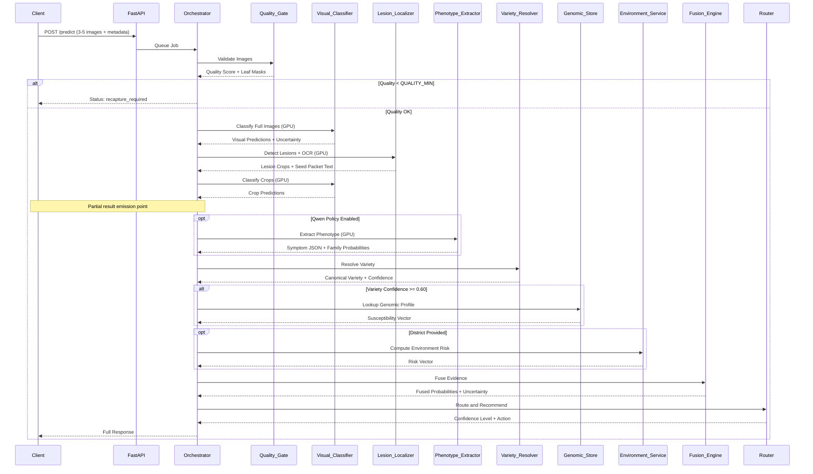
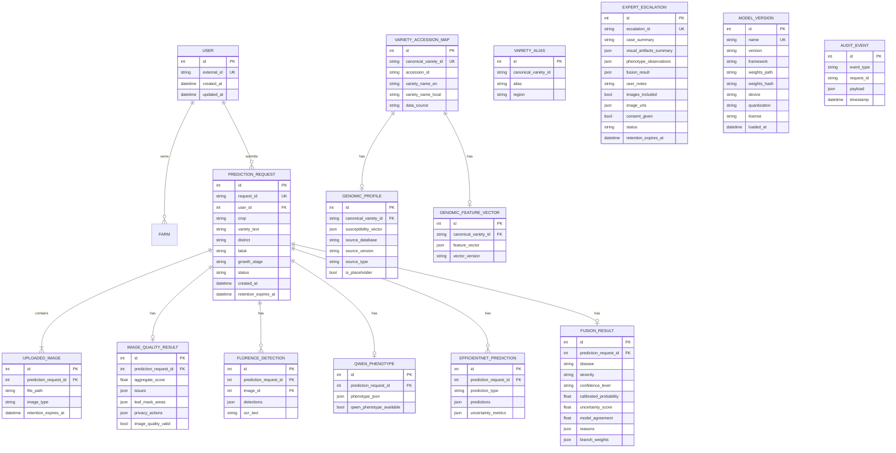

# Design Document: Phase 1 Foundation


## Decisions

Where any code sketch conflicts with this table or requirements.md, the table wins; code blocks are illustrative.

| Decision | Details |
|----------|---------|
| **LoadableService** | One async `load()`/`unload()` for all models (Visual, Localizer, Phenotype). No `AsyncLoadable`. Orchestrator wraps the inference calls in `to_thread`. |
| **Pipeline Order** | Quality -> Visual(Full) -> Localizer(Detect+OCR in one load, classical fallback) -> Crops -> Visual(Crops) -> store partial -> Qwen(policy) -> Variety(no visual_guess) -> Genomic -> Env -> Fusion -> Routing -> Response. |
| **GPU Management** | Single `GpuLock`. No top-level `import torch` in orchestrator. `unload()` uses lazy-torch helper for `gc.collect()` and `torch.cuda.empty_cache()`. `try/finally` around every unload. |
| **Queuing** | `asyncio.Queue(maxsize)` with one worker loop. Orphaned "processing" jobs marked failed at startup. |
| **Fusion Weights** | branch_weights reported must be the EFFECTIVE weights (0 for absent/disabled). |
| **Disagreement** | JS Divergence base 2 is natively in [0,1]; no division by `log2(7)`. |
| **Phenotype Families** | Non-disease families excluded from logits, added to uncertainty and trigger `non_disease_family_suspected` reason for routing. Remove `log()` add. |
| **Model Agreement** | Compares ONLY visual top class's family vs Qwen family. Genomic is a prior and excluded from agreement/conflict logic. |
| **Uncertainty** | Components passed as arguments (not config lookups). Weights loaded from config. |
| **Severity** | Per-image union of lesion pixels intersected with lesion colors, divided by filled leaf mask. Averaged across images, clipped [0,1]. No stubs. |
| **Variety Resolver** | Uses injected in-memory alias index loaded at startup. No Qwen `visual_guess`. Resolves conflicts if barcode/OCR/dropdown disagree. |
| **Genomic/Env** | Genomic returns `None` on miss + degraded mode (no raise). `/genotype/profile` returns metadata only. |
| **Tooling** | Manual magic-byte + Pillow verify (no python-magic). `httpx.ASGITransport` for tests. `download_models.py` uses `--record-lock`. |
| **Duplication** | No ORM duplicates, no `eval`-style yaml, no `thresholds.yaml` (use `fusion_config.yaml` / `.env`). |
| **Qwen Schema** | Strict schema (`region_id`, `bbox`, `visible_symptoms`, `whole_leaf`, `limitations`), reject names, versioned prompt. |
| **Expert Portal** | Only `POST /expert/escalate` remains. Escalation copies consented images to its own store. No treatment advice in examples. |

## Overview

Tree of Life Phase 1 is a local crop-disease decision-support backend targeting rice diseases in Karnataka. The system operates on consumer-grade Windows hardware (RTX 4050 Laptop, 6GB VRAM) without paid APIs or cloud dependencies. It analyzes 3–5 rice leaf photographs plus optional metadata through three evidence branches:

1. **Phenotype Branch** (Visual): Image quality validation → Lesion localization → EfficientNet-B0 classification → Qwen2.5-VL symptom extraction
2. **Genotype Branch** (Variety-level Prior): Variety resolution → Local genomic susceptibility lookup
3. **Environment Branch** (Optional Risk): Weather data → Rule-based disease risk computation

These branches fuse mathematically to produce calibrated disease predictions with confidence levels, severity estimates, and action recommendations. All outputs are decision support, not laboratory diagnoses.

### Key Design Constraints

- **Hardware**: RTX 4050 6GB VRAM, never load Florence-2-large and Qwen2.5-VL simultaneously
- **Platform**: Windows 64-bit with sync models on single-thread executor
- **Network**: No paid APIs, optional free Open-Meteo weather (cached)
- **Honesty**: Never claim DNA sequencing of user's plant; genomic data is variety-level only
- **Safety**: No pesticide brands or quantities; low confidence requires recapture or expert consultation
- **Graceful Degradation**: Any optional component failure continues pipeline with marked unavailability
- **Calibration Status**: Fused probabilities are provisional until fusion temperature fitted on validation data

### Research Needs

Before finalizing design decisions, the following areas require research:

1. **Temperature Scaling Implementation**: Calibration techniques for EfficientNet-B0 probabilities (Expected Calibration Error, Brier score) and fusion temperature fitting on validation data
2. **Out-of-Distribution Detection**: Energy-based scoring calibrated on validation set
3. **Qwen JSON Validation**: JSON repair libraries compatible with Windows (json-repair, jsonformer)
4. **Florence-2 Windows Compatibility**: Native support in transformers vs trust_remote_code with pinned revision, attention implementation defaults to "eager" with optional "sdpa"
5. **Bitsandbytes on Windows**: 4-bit NF4 quantization setup for Qwen2.5-VL-3B-Instruct
6. **Non-Maximum Suppression**: IoU threshold selection for lesion deduplication, proxy confidence for Florence detections
7. **Fusion Metrics**: Jensen-Shannon divergence for disagreement, family conflict measure, model agreement measure
8. **HSV Thresholds**: Green vegetation mask and lesion detection color ranges for Karnataka rice varieties
9. **SQLAlchemy 2.0 Patterns**: Sync session management in threadpool, JSON/JSONB column handling for SQLite/PostgreSQL portability
10. **Upload Validation**: Magic byte validation for image files (not just extensions)


## Architecture

### System Architecture Diagram

```mermaid
graph TB
    Client[Client Application]
    Expert[Expert/Admin Portal]
    API[FastAPI API Layer]
    Queue[Async Job Queue]
    Orch[Orchestrator]
    
    QG[Quality Gate]
    VC[Visual Classifier]
    LL[Lesion Localizer]
    PE[Phenotype Extractor]
    VR[Variety Resolver]
    GS[Genomic Store]
    ES[Environment Service]
    FE[Fusion Engine]
    RT[Router]
    
    GPU[GPU Lock]
    DB[(Database)]
    FileStore[File Storage]
    Cache[Weather Cache]
    
    Client -->|POST /predict| API
    API --> Queue
    Queue --> Orch
    
    Orch --> QG
    QG --> VC
    VC -.->|acquire| GPU
    VC --> LL
    LL -.->|acquire| GPU
    LL --> FileStore
    LL --> VC
    VC --> PE
    PE -.->|acquire| GPU
    PE --> VR
    VR --> GS
    GS --> DB
    VR --> ES
    ES --> Cache
    ES --> FE
    GS --> FE
    PE --> FE
    VC --> FE
    FE --> RT
    RT --> DB
    RT -->|Response| Client
    
    Client -->|POST /expert/escalate| API
    API --> DB
    
    Expert -->|GET /expert/cases| API
    API --> DB
    Expert -->|POST /expert/cases/{id}/reply| API
    API --> DB
    
    style GPU fill:#f96,stroke:#333,stroke-width:2px
    style Orch fill:#9cf,stroke:#333,stroke-width:2px
    style FE fill:#9f9,stroke:#333,stroke-width:2px
    style Expert fill:#fc9,stroke:#333,stroke-width:2px
```

### Data Flow Pipeline



### Module Structure

Following `structure.md` conventions:

```
app/
├── main.py                     # FastAPI app factory, lifespan, routers
├── core/                       # Cross-cutting concerns
│   ├── config.py              # Pydantic settings from .env
│   ├── logging.py             # Structured logging (no PII)
│   ├── errors.py              # Typed error hierarchy
│   ├── gpu.py                 # VRAM monitoring helpers
│   ├── security.py            # EXIF stripping, magic byte validation
│   └── rate_limit.py          # IP-based rate limiting
├── api/v1/                    # REST endpoints
│   ├── predict.py             # POST /disease/predict, GET /disease/result/{id}
│   ├── jobs.py                # GET /jobs/{id}
│   ├── variety.py             # POST /variety/resolve
│   ├── genotype.py            # GET /genotype/profile/{id} (metadata only)
│   ├── expert.py              # POST /expert/escalate [OPTIONAL: GET /expert/cases, POST /expert/cases/{id}/reply - move to later spec unless confirmed]
│   └── health.py              # GET /models/health
├── schemas/                   # Pydantic models
│   ├── common.py              # Shared types, enums
│   ├── quality.py             # QualityResult
│   ├── localizer.py           # LesionDetection, OCRResult
│   ├── phenotype.py           # PhenotypeObservation (from strict Qwen schema), FamilyDistribution
│   ├── visual.py              # VisualPrediction, CalibrationParams
│   ├── variety.py             # VarietyResolution
│   ├── genomic.py             # GenomicProfile, SusceptibilityVector
│   ├── environment.py         # WeatherData, RiskVector
│   ├── fusion.py              # FusionResult, FusionConfig, UncertaintyScore
│   └── response.py            # PredictResponse, PartialResult
├── db/                        # Database layer
│   ├── base.py                # Declarative base
│   ├── models.py              # SQLAlchemy ORM models (renamed: FusionResultRow, etc.)
│   ├── session.py             # Sync session factory with threadpool
│   ├── repositories.py        # Data access layer
│   ├── seed.py                # Idempotent seed script
│   └── alembic/               # Migrations
├── services/                  # Business logic
│   ├── interfaces.py          # Protocol definitions for all services
│   ├── quality/
│   │   └── checks.py          # Resolution, blur (normalized), exposure, duplicates, leaf coverage (morphological fill), EXIF strip
│   ├── localizer/
│   │   ├── base.py            # LesionLocalizerProtocol
│   │   ├── florence.py        # Florence-2-large with OCR and proxy confidence
│   │   ├── classical.py       # HSV-based fallback (proper implementation)
│   │   └── mock.py            # Deterministic mock
│   ├── phenotype/
│   │   ├── base.py            # PhenotypeExtractorProtocol
│   │   ├── qwen.py            # Qwen2.5-VL-3B-Instruct with versioned prompt
│   │   ├── mock.py            # Deterministic mock
│   │   ├── json_repair.py     # JSON validation + repair
│   │   └── aggregate.py       # Aggregate lesion observations, derive family_distribution
│   ├── visual/
│   │   ├── base.py            # VisualClassifierProtocol
│   │   ├── efficientnet.py    # EfficientNet-B0 with calibration
│   │   ├── mock.py            # Deterministic mock
│   │   ├── calibration.py     # Temperature scaling
│   │   ├── ood.py             # Energy-based OOD detection
│   │   └── aggregate.py       # Cross-image aggregation, full+crop aggregation, JS divergence disagreement
│   ├── variety/
│   │   ├── resolver.py        # Multi-source priority resolution with in-memory alias index
│   │   ├── fuzzy.py           # Rapidfuzz matching (names only, not codes)
│   │   └── barcode.py         # QR/barcode parsing (future)
│   ├── genomic/
│   │   ├── store.py           # GenomicStoreProtocol
│   │   └── lookup.py          # Variety-level profile lookup (returns None for disabled placeholders)
│   ├── environment/
│   │   ├── weather.py         # Open-Meteo fetcher + cache
│   │   └── risk_rules.py      # Structured min/max rule computation (no eval)
│   ├── fusion/
│   │   ├── fuse.py            # Multi-modal evidence fusion (anchored visual weight)
│   │   ├── uncertainty.py     # Entropy, JS divergence, family conflict, OOD
│   │   ├── routing.py         # Complete confidence level + action recommendation logic
│   │   └── reasons.py         # Machine-readable reason codes
│   └── registry/
│       └── model_registry.py  # Model version tracking
├── pipeline/                  # Orchestration
│   ├── orchestrator.py        # Main pipeline controller (sync models on executor)
│   ├── queue.py               # Bounded async job queue
│   ├── gpu_lock.py            # Async-safe GPU serialization (single instance, canonical)
│   ├── storage.py             # Temporary file management
│   └── janitor.py             # Background retention cleanup (files before DB rows)
├── workers/                   # Future: separate worker processes
└── scripts/
    └── download_models.py     # HF model download with pinned revisions and SHA256 verification
```


## Components and Interfaces

### Service Protocol Pattern

Every model-backed capability follows this pattern:

```python
# app/services/interfaces.py
from typing import Protocol
from abc import abstractmethod

class LoadableService(Protocol):
    """Services that require initialization/cleanup on dedicated executor."""
    async def load(self) -> None:
        """Load resources (models, connections) asynchronously."""
        ...
    
    async def unload(self) -> None:
        """Release resources and clear caches asynchronously."""
        ...

class VisualClassifierProtocol(LoadableService, Protocol):
    def classify_full(self, images: list[np.ndarray]) -> list[VisualPrediction]:
        ...
    def classify_crops(self, crops: list[np.ndarray]) -> list[VisualPrediction]:
        ...

# Aggregation via visual/aggregate.py in orchestrator AFTER crops
```

**CRITICAL**: Model methods are SYNCHRONOUS. Orchestrator wraps them on a single-thread executor.

**Factory Pattern**:

```python
# app/services/visual/factory.py
def create_visual_classifier(config: Settings) -> VisualClassifierProtocol:
    if config.USE_REAL_EFFICIENTNET:
        from .efficientnet import EfficientNetClassifier
        return EfficientNetClassifier(config)
    else:
        from .mock import MockVisualClassifier
        return MockVisualClassifier(config)
```

### Key Service Interfaces

#### 1. Quality_Gate (app/services/quality/checks.py)

**No load/unload** (pure CPU functions)

```python
@dataclass
class QualityResult:
    aggregate_score: float  # 0.0 to 1.0
    issues: list[QualityIssue]  # blur, exposure, duplicates, coverage
    leaf_mask_areas: list[int]  # pixels, for severity computation
    privacy_actions: list[str]  # ["EXIF_stripped", "location_reduced"]
    image_quality_valid: bool
    recapture_guidance: str | None
```

Functions:
- `validate_resolution(image: np.ndarray, min_short_side: int = 512) -> bool` - configurable minimum
- `compute_blur_variance(image: np.ndarray) -> float` - resize first for normalized variance
- `detect_exposure_issues(image: np.ndarray) -> tuple[bool, bool]`
- `compute_perceptual_hash(image: np.ndarray) -> str`
- `find_duplicates(hashes: list[str]) -> list[int]`
- `create_green_mask(image: np.ndarray) -> np.ndarray` - with morphological close/fill
- `compute_leaf_coverage(mask: np.ndarray) -> float`
- `strip_exif(image_bytes: bytes) -> bytes`
- `validate_magic_bytes(image_bytes: bytes) -> bool` - check actual file type
- `aggregate_quality_score(checks: dict) -> float`

#### 2. Lesion_Localizer (app/services/localizer/)

**Protocol**:

```python
class LesionLocalizerProtocol(LoadableService, Protocol):
    def detect_and_ocr(self, images: list[np.ndarray], seed_packet_image: np.ndarray | None) -> tuple[list[list[LesionDetection]], OCRResult | None]:
        """Detect lesions and OCR seed packet in one sync load."""
        ...
```

**Implementations**:
- `florence.py`: Florence-2-large FP16, tasks `<OD>` (no confidence scores - use proxy confidence based on box size/position) and `<OCR_WITH_REGION>`
- `classical.py`: HSV-based contour detection fallback (proper implementation, not stub)
- `mock.py`: Returns fixed bounding boxes

**NMS Algorithm**:

```python
def non_maximum_suppression(
    detections: list[Detection],
    iou_threshold: float = 0.5
) -> list[Detection]:
    """Deduplicate overlapping detections using IoU."""
    # Sort by confidence descending
    # For each detection, suppress lower-confidence overlapping boxes
    # Return top 5
```

**Florence Proxy Confidence**:

Since Florence-2 `<OD>` task doesn't provide confidence scores, define proxy confidence:
- Based on lesion box size (larger boxes = higher confidence)
- Or position (center-weighted confidence)
- Or uniform confidence if no better heuristic available

#### 3. Visual_Classifier (app/services/visual/)

**Protocol**: See above

**EfficientNet Implementation** (`efficientnet.py`):

```python
class EfficientNetClassifier:
    def __init__(self, config: Settings):
        self.model: torch.nn.Module | None = None
        self.device: str = "cuda" if torch.cuda.is_available() else "cpu"
        self.calibration_params: CalibrationParams | None = None
    
    async def load(self) -> None:
        """Asynchronous load."""
        # Load EfficientNet-B0 with ImageNet backbone
        # Replace final layer with 7-class head
        # Load trained checkpoint from registry
        # Load temperature scaling parameters
        # Move to GPU in FP16
        # Log VRAM usage
        # NO async/await - this is synchronous
    
    def classify_full(
        self,
        images: list[np.ndarray]
    ) -> list[VisualPrediction]:
        ...

    def classify_crops(
        self,
        crops: list[np.ndarray]
    ) -> list[VisualPrediction]:
        """
        Synchronous inference on executor thread.
        
        Algorithm:
        1. For each image: full-image inference -> logits_full
        2. If crops available: inference on each crop -> logits_crops
        3. Aggregate across images: quality-weighted mean logits (see visual/aggregate.py)
        4. Aggregate full+crops per image (see visual/aggregate.py)
        5. Apply temperature scaling
        6. Softmax -> probabilities
        7. Compute entropy
        8. Compute OOD score (energy-based)
        9. Compute disagreement AFTER aggregation using Jensen-Shannon divergence
        10. Return results
        
        NO torch.cuda.empty_cache() here - done in orchestrator unload
        """
    
    async def unload(self) -> None:
        """Asynchronous unload."""
        # del self.model
        # DO NOT call gc.collect() or torch.cuda.empty_cache() here
        # Orchestrator handles cleanup
        # Log VRAM released
```

**Temperature Scaling** (`calibration.py`):

```python
def apply_temperature_scaling(
    logits: torch.Tensor,
    temperature: float
) -> torch.Tensor:
    """Scale logits by learned temperature parameter."""
    return logits / temperature
```

**OOD Detection** (`ood.py`):

```python
def compute_ood_probability(
    logits: torch.Tensor,
    calibration_params: CalibrationParams
) -> float:
    """
    Compute OOD probability from calibrated energy score.
    
    Returns max of:
    - P(unknown_or_ood class) from softmax
    - Calibrated energy-based score
    
    Energy score calibrated on validation set (not max-logit heuristic).
    """
    probs = torch.softmax(logits, dim=-1)
    unknown_ood_class_prob = probs[-1].item()  # Last class
    
    # Energy-based score
    energy = -torch.logsumexp(logits, dim=-1).item()
    # Apply calibration from validation set
    energy_prob = sigmoid(energy * calibration_params.energy_scale + calibration_params.energy_bias)
    
    return max(unknown_ood_class_prob, energy_prob)
```

**Aggregation** (`aggregate.py`):

```python
def aggregate_cross_images(
    predictions: list[VisualPrediction],
    quality_scores: list[float]
) -> np.ndarray:
    """
    Aggregate logits across multiple images using quality-weighted mean.
    
    Returns: aggregated logits array
    """
    weights = np.array(quality_scores)
    weights = weights / weights.sum()
    
    logits_stack = np.stack([pred.logits for pred in predictions])
    aggregated_logits = (logits_stack * weights[:, None]).sum(axis=0)
    
    return aggregated_logits

def aggregate_full_and_crops(
    full_logits: np.ndarray,
    crop_logits: list[np.ndarray]
) -> tuple[np.ndarray, float]:
    """
    Aggregate full-image and crop predictions.
    
    Returns:
        (aggregated_logits, disagreement_js_divergence)
    """
    # Mean-crop aggregation
    mean_crop_logits = np.mean(crop_logits, axis=0) if crop_logits else full_logits
    
    # Weighted combination (can adjust weights)
    aggregated = 0.6 * full_logits + 0.4 * mean_crop_logits
    
    # Compute disagreement AFTER aggregation
    disagreement = compute_js_divergence(
        softmax(full_logits),
        softmax(mean_crop_logits)
    )
    
    return aggregated, disagreement

def compute_js_divergence(p: np.ndarray, q: np.ndarray) -> float:
    """
    Compute Jensen-Shannon divergence between two probability distributions.
    
    JSD(P||Q) = 0.5 * KL(P||M) + 0.5 * KL(Q||M), where M = 0.5 * (P + Q)
    Base 2 for normalization to [0, 1].
    
    Returns value in [0, 1].
    """
    m = 0.5 * (p + q)
    kl_pm = np.sum(p * np.log2(p / m + 1e-10))
    kl_qm = np.sum(q * np.log2(q / m + 1e-10))
    jsd = 0.5 * kl_pm + 0.5 * kl_qm
    # JSD is in [0, 1] for base-2 log with binary distributions
    # JSD is in [0, 1] natively for base-2 log
    return np.clip(jsd, 0.0, 1.0)
```

#### 4. Phenotype_Extractor (app/services/phenotype/)

**Protocol**:

```python
class PhenotypeExtractorProtocol(LoadableService, Protocol):
    def extract_phenotype(self, full_image: np.ndarray, lesion_crops: list) -> PhenotypeObservation:
        ...

class QwenPhenotypeExtractor(PhenotypeExtractorProtocol):
    async def load(self) -> None:
        # Async load 4-bit NF4
        pass
        
    async def unload(self) -> None:
        # Sync unload + clear cache
        pass
        
    def extract_phenotype(self, full_image: np.ndarray, lesion_crops: list) -> PhenotypeObservation:
        # Sync extraction
        pass

class QwenOutputSchema(BaseModel):
    # Strict Pydantic schema; reject outputs naming diseases
    region_id: str
    bbox: list[int]
    visible_symptoms: str
    whole_leaf: str
    limitations: str
    # Note: family_distribution derived in aggregate.py, NOT emitted by Qwen directly.
```

**Qwen Implementation** (`qwen.py`):

```python
class QwenPhenotypeExtractor:
    def __init__(self, config: Settings):
        self.model = None
        self.processor = None
        self.device = "cuda" if torch.cuda.is_available() else "cpu"
    
    async def load(self) -> None:
        # Load Qwen2.5-VL-3B-Instruct
        # 4-bit NF4 quantization via bitsandbytes
        # Configure min_pixels=256*28*28, max_pixels=512*28*28
        # Log VRAM usage
    
    async def extract_phenotype(self, ...) -> PhenotypeObservation:
        # Prepare messages with full image + crops + coordinates
        # Request JSON output matching phenotype schema
        # Run inference: max_new_tokens=512, greedy decoding
        # Parse JSON
        # Validate with Pydantic
        # If validation fails: attempt json-repair
        # If still fails: return qwen_phenotype_available=false
        # Extract family_distribution, lesion_observations, whole_leaf
        # Aggregate mean confidence
        # Return structured result
    
    async def unload(self) -> None:
        # del model, processor
        # gc.collect()
        # torch.cuda.empty_cache()
```

**JSON Repair** (`json_repair.py`):

```python
def repair_json(malformed: str) -> dict:
    """Attempt to fix common JSON errors."""
    # Use json-repair library or custom heuristics
    # Fix trailing commas, missing quotes, unclosed brackets
    # Raise if unrepairable
```

**Phenotype Schema**:

```python
@dataclass
class LesionObservation:
    color: str  # "brown", "yellow", "white"
    shape: str  # "round", "elongated", "irregular"
    margin: str  # "sharp", "diffuse"
    texture: str  # "smooth", "rough", "powdery"
    tissue_response: str  # "necrotic", "chlorotic", "water_soaked"
    affected_percent: float  # 0-100
    distribution: str  # "scattered", "clustered", "linear"
    possible_cause_family: str  # "fungal", "bacterial", "viral", etc.
    observation_confidence: float  # 0.0-1.0

@dataclass
class PhenotypeObservation:
    crop_guess: str | None
    visual_quality: dict  # is_usable, quality_score
    lesion_observations: list[LesionObservation]
    whole_leaf_observations: dict  # overall_affected_percent, dominant_pattern
    family_distribution: dict[str, float]  # {"fungal": 0.7, "bacterial": 0.2, ...}
    mean_observation_confidence: float
    qwen_phenotype_available: bool
```

#### 5. Variety_Resolver (app/services/variety/resolver.py)

**Protocol**: Sync (pure logic). Uses injected in-memory alias index loaded at startup.

```python
@dataclass
class VarietyResolution:
    canonical_variety_name: str
    source: str  # seed_packet_ocr | barcode | farmer_dropdown | expert | unknown (NO visual_guess)
    mapping_confidence: float  # 0.0-1.0
    requires_user_confirmation: bool
    crop_variety_inconsistency: bool

def resolve_variety(
    seed_packet_text: str | None,
    barcode: str | None,
    farmer_dropdown: str | None,
    expert_input: str | None,
    user_crop: str,
    alias_index: dict  # Injected in-memory index
) -> VarietyResolution:
    # Priority order: seed_packet_ocr, barcode, farmer_dropdown, expert
    # Code tokens (barcode/OCR) must be exact-after-normalisation
    # Names (dropdown/OCR) can be fuzzy matched against alias_index
    # Conflict handling: If barcode/OCR/dropdown disagree, resolve by priority and flag for confirmation.
    # Return resolution
```


#### 6. Genomic_Store (app/services/genomic/)

**Protocol**: Sync (`LoadableService`).

```python
class GenomicStoreProtocol(LoadableService, Protocol):
    def lookup_profile(
        self,
        canonical_variety_id: str,
        variety_confidence: float
    ) -> tuple[GenomicProfile | None, bool]:
        """
        Lookup variety-level susceptibility profile.
        Returns (profile, degraded_mode_flag).
        Never raises exceptions on missing data; returns (None, True).
        """
        ...
```

#### 7. Environment_Service (app/services/environment/)

**No async load/unload** (HTTP calls wrapped in asyncio)

```python
@dataclass
class RiskVector:
    disease_risks: dict[str, float]  # 5 diseases: 0.0-1.0
    weather_available: bool
    weather_source: str
    rules_validated: bool  # Always false in Phase 1

async def compute_environment_risk(
    district: str | None,
    taluk: str | None
) -> RiskVector:
    # If no location: return weather_available=false
    # Fetch weather from Open-Meteo (cached on disk)
    # Load risk rules from configs/environment_risk_rules.yaml
    # Apply rules: e.g., high humidity + warm temp -> blast risk
    # Mark rules_validated=false
    # Return risk vector with weight 0.1
```

#### 8. Fusion_Engine (app/services/fusion/fuse.py)

**No async load/unload** (pure functions)

**Core Algorithm**:

```python
def fuse_evidence(
    visual_logits: np.ndarray,  # (7,) scaled by temperature
    genomic_susceptibility: dict[str, float] | None,  # MUST have all 5 disease keys or None
    phenotype_family_probs: dict[str, float] | None,  # Derived from Qwen observations
    phenotype_confidence: float,
    environment_risk: dict[str, float] | None,  # MUST have all 5 disease keys or None
    variety_confidence: float,
    quality_score: float,
    config: FusionConfig
) -> FusionResult:
    """
    Fuse multi-modal evidence into provisional disease probabilities.
    
    CRITICAL: This formula anchors visual weight at 1, NOT renormalizing weights.
    Formula: fused_logits = z_v + (w_g/w_v)*g + (w_p/w_v)*p + (w_e/w_v)*e
    
    # Effective weights are returned (0 for absent/disabled modalities)
    # No branch weight renormalizing in the math
```

**CRITICAL TEST**: When all non-visual terms are zero → fused_probs MUST equal visual_probs.

**Uncertainty Computation** (`uncertainty.py`):

```python
def compute_uncertainty_score(
    visual_logits: np.ndarray,
    genomic_term: np.ndarray,
    phenotype_term: np.ndarray,
    quality_score: float,
    extra_phenotype_uncertainty: float,
    config: FusionConfig
) -> float:
    """
    Bounded weighted sum of uncertainty components.
    
    Components (all normalized to [0,1]):
    - Normalized entropy from visual probabilities
    - Disagreement (Jensen-Shannon divergence) between full-image and crop distributions
    - Family conflict between Qwen family and genomic susceptibility
    - (1 - quality_score)
    - OOD probability
    - Extra uncertainty from non-disease Qwen families
    
    Weights loaded from config.uncertainty_weights.
    """
    # Entropy
    probs = softmax(visual_logits)
    entropy = -np.sum(probs * np.log(probs + 1e-8))
    max_entropy = np.log(len(probs))
    normalized_entropy = entropy / max_entropy
    
    # Disagreement: injected from visual classifier (Jensen-Shannon divergence)
    disagreement = config.get("disagreement", 0.0)  # Already normalized [0,1]
    
    # Family conflict: measure disagreement between Qwen family and genomic susceptibility
    family_conflict = config.get("family_conflict", 0.0)  # Already computed, [0,1]
    
    # OOD probability: already computed from calibrated energy score
    ood_prob = config.get("ood_probability", 0.0)  # [0,1]
    
    # Quality penalty
    quality_penalty = 1.0 - quality_score
    
    # Uncertainty weights from config
    weights = config.uncertainty_weights  # e.g., {"entropy": 0.25, "disagreement": 0.20, ...}
    
    uncertainty = (
        weights["entropy"] * normalized_entropy +
        weights["disagreement"] * disagreement +
        weights["family_conflict"] * family_conflict +
        weights["quality_penalty"] * quality_penalty +
        weights["ood_probability"] * ood_prob +
        weights.get("extra_phenotype_uncertainty", 0.1) * extra_phenotype_uncertainty
    )
    
    return np.clip(uncertainty, 0.0, 1.0)

def compute_family_conflict(
    phenotype_family_probs: dict[str, float] | None,
    genomic_susceptibility: dict[str, float] | None
) -> float:
    """
    Measure disagreement between Qwen-predicted families and genomic susceptibility.
    
    Algorithm:
    - For each disease: check if Qwen family matches class family
    - If genomic says high susceptibility but Qwen says different family: conflict
    
    Returns: conflict score in [0, 1]
    """
    if phenotype_family_probs is None or genomic_susceptibility is None:
        return 0.0
    
    class_to_family = {
        "rice_blast": "fungal",
        "rice_brown_spot": "fungal",
        "bacterial_leaf_blight": "bacterial",
        "rice_leaf_scald": "fungal",
        "rice_tungro": "viral"
    }
    
    conflicts = []
    for disease, family in class_to_family.items():
        if disease in genomic_susceptibility:
            genomic_susc = genomic_susceptibility[disease]
            qwen_family_prob = phenotype_family_probs.get(family, 0.0)
            
            # Conflict if genomic high but Qwen family low
            if genomic_susc > 0.6 and qwen_family_prob < 0.3:
                conflicts.append(genomic_susc - qwen_family_prob)
            # Or genomic low but Qwen family high
            elif genomic_susc < 0.3 and qwen_family_prob > 0.6:
                conflicts.append(qwen_family_prob - genomic_susc)
    
    if not conflicts:
        return 0.0
    
    return np.clip(np.mean(conflicts), 0.0, 1.0)

def compute_model_agreement(
    visual_probs: np.ndarray,
    phenotype_family_probs: dict[str, float] | None,
    genomic_susceptibility: dict[str, float] | None
) -> float:
    """
    Measure agreement between visual, phenotype family, and genomic susceptibility.
    
    Returns: agreement score in [0, 1], where 1 = all agree, 0 = all disagree
    """
    # Get visual top class and family
    classes = ["healthy", "rice_blast", "rice_brown_spot", 
               "bacterial_leaf_blight", "rice_leaf_scald", 
               "rice_tungro", "unknown_or_ood"]
    class_to_family = {
        "rice_blast": "fungal",
        "rice_brown_spot": "fungal",
        "bacterial_leaf_blight": "bacterial",
        "rice_leaf_scald": "fungal",
        "rice_tungro": "viral"
    }
    
    visual_top_idx = np.argmax(visual_probs)
    visual_top_class = classes[visual_top_idx]
    visual_top_prob = visual_probs[visual_top_idx]
    
    if visual_top_class not in class_to_family:
        return 0.5  # Neutral for healthy/unknown
    
    visual_family = class_to_family[visual_top_class]
    
    agreements = []
    
    # Visual vs Phenotype
    if phenotype_family_probs:
        phenotype_family_prob = phenotype_family_probs.get(visual_family, 0.0)
        agreements.append(phenotype_family_prob)
    
    # Visual vs Genomic
    if genomic_susceptibility and visual_top_class in genomic_susceptibility:
        genomic_susc = genomic_susceptibility[visual_top_class]
        agreements.append(genomic_susc)
    
    if not agreements:
        return 0.5  # Neutral
    
    return np.clip(np.mean(agreements), 0.0, 1.0)
```

#### 9. Router (app/services/fusion/routing.py)

**No load/unload** (pure logic)

```python
def route_and_recommend(
    fusion_result: FusionResult,
    quality_score: float,
    normalized_entropy: float,  # Already normalized [0,1]
    ood_prob: float,
    disagreement: float,  # Jensen-Shannon divergence [0,1]
    severity: str,
    variety_inconsistency_flag: bool,
    no_detections_and_low_visual_conf: bool,
    config: FusionConfig
) -> tuple[str, str, str]:
    """
    Determine confidence level, status, and recommended action.
    
    COMPLETE ROUTING LOGIC from requirements:
    
    Returns:
        (confidence_level, status, action_type)
    
    Escalation triggers:
    - Top class is unknown_or_ood
    - OOD probability > OOD_THRESHOLD
    - Strong branch disagreement (disagreement > DISAGREEMENT_THRESHOLD)
    - Variety inconsistency flag set
    - No detections AND low visual confidence
    - Top probability < 0.60
    - Quality score < 0.50
    
    Confidence levels:
    - High: prob >= 0.80, quality >= 0.70, entropy < threshold, no contradictions, OOD < threshold
    - Moderate: prob 0.60-0.80 or moderate quality/disagreement
    - Low: triggers escalation
    
    Actions:
    - monitor: high confidence healthy or low-severity
    - recapture_images: quality < QUALITY_MIN
    - consult_expert: escalated
    - treatment_advisory_pending_validation: moderate/high severity with sufficient confidence
    """
    top_prob = fusion_result.calibrated_probability
    disease = fusion_result.disease
    
    # Recapture already handled in quality gate
    # This routes after fusion
    
    # Check escalation triggers
    escalation_reasons = []
    
    if disease == "unknown_or_ood":
        escalation_reasons.append("top_class_unknown_or_ood")
    
    if ood_prob > config.OOD_THRESHOLD:
        escalation_reasons.append("ood_probability_exceeds_threshold")
    
    if disagreement > config.DISAGREEMENT_THRESHOLD:
        escalation_reasons.append("strong_disagreement_full_vs_crop")
    
    if variety_inconsistency_flag:
        escalation_reasons.append("variety_inconsistency")
    
    if no_detections_and_low_visual_conf:
        escalation_reasons.append("no_lesion_detections_low_visual_confidence")
    
    if top_prob < 0.60:
        escalation_reasons.append("low_prediction_probability")
    
    if quality_score < 0.50:
        status = "insufficient_data"
        action = "recapture_images"
        confidence_level = "low"
        return confidence_level, status, action
    
    # Escalated status
    if escalation_reasons:
        confidence_level = "low"
        status = "escalated"
        action = "consult_expert"
        return confidence_level, status, action
    
    # High confidence
    if (top_prob >= 0.80 and 
        quality_score >= 0.70 and 
        normalized_entropy < config.ENTROPY_THRESHOLD and 
        ood_prob < config.OOD_THRESHOLD):
        
        confidence_level = "high"
        status = "success"
        
        if disease == "healthy" or severity == "low":
            action = "monitor"
        else:
            action = "treatment_advisory_pending_validation"
    
    # Moderate confidence
    elif top_prob >= 0.60:
        confidence_level = "moderate"
        status = "success"
        action = "monitor"  # No treatment advice for moderate confidence
    
    else:
        # Should have been caught by escalation, but safety fallback
        confidence_level = "low"
        status = "escalated"
        action = "consult_expert"
    
    return confidence_level, status, action
```

### 10. Orchestrator (app/pipeline/orchestrator.py)

**Corrected Stage Order** (from requirements 11.1):

1. Quality_Gate
2. Visual_Classifier on full images
3. Lesion_Localizer (localization and OCR)
4. Crop generation
5. Visual_Classifier on crops
6. Partial result emission
7. Phenotype_Extractor per policy
8. Variety_Resolver
9. Genomic_Store lookup
10. Environment_Service
11. Fusion_Engine
12. Router
13. Response construction

**GPU Management**:

```python
class Orchestrator:
    def __init__(
        self,
        quality_gate: QualityGate,
        visual_classifier: VisualClassifierProtocol,
        lesion_localizer: LesionLocalizerProtocol,
        phenotype_extractor: PhenotypeExtractorProtocol,
        variety_resolver: VarietyResolver,
        genomic_store: GenomicStoreProtocol,
        environment_service: EnvironmentService,
        fusion_engine: FusionEngine,
        router: Router,
        gpu_lock: GpuLock,
        config: Settings
    ):
        self.quality_gate = quality_gate
        self.visual = visual_classifier
        self.localizer = lesion_localizer
        self.phenotype = phenotype_extractor
        self.variety = variety_resolver
        self.genomic = genomic_store
        self.environment = environment_service
        self.fusion = fusion_engine
        self.router = router
        self.gpu_lock = gpu_lock
        self.config = config
    
    async def process_prediction(
        self,
        request: PredictRequest
    ) -> PredictResponse:
        """
        Execute pipeline with graceful degradation.
        """
        # Stage 1: Quality Gate (CPU)
        quality_result = self.quality_gate.validate_images(request.images)
        
        if not quality_result.image_quality_valid:
            return self._build_recapture_response(quality_result)
        
        # Stage 2: Visual full images (GPU)
        async with self.gpu_lock.acquire("ModelName"):
            try:
                await self.visual.load()
                visual_full = await asyncio.to_thread(
                    self.visual.classify_image,
                    request.images,
                    candidate_regions=None
                )
            except torch.cuda.OutOfMemoryError:
                logger.error("Visual OOM on GPU, retrying on CPU")
                self.visual.device = "cpu"
                await self.visual.load()
                visual_full = await asyncio.to_thread(
                    self.visual.classify_image,
                    request.images
                )
            # Keep loaded if residency policy is batch_stage
            if self.config.MODEL_RESIDENCY == "on_demand":
                await self.visual.unload()
        
        # Stage 3: Lesion localization + OCR (GPU)
        async with self.gpu_lock.acquire("ModelName"):
            try:
                await self.localizer.load()
                detections = await asyncio.to_thread(
                    self.localizer.detect_lesions,
                    request.images
                )
                seed_ocr = None
                if request.seed_packet_image:
                    seed_ocr = await asyncio.to_thread(
                        self.localizer.ocr_seed_packet,
                        request.seed_packet_image
                    )
                await self.localizer.unload()
                gc.collect()
                torch.cuda.empty_cache()
            except Exception as e:
                logger.warning(f"Lesion localizer failed: {e}, using full images")
                detections = []
                seed_ocr = None
        
        # Stage 4: Crop generation (CPU)
        crops = self._generate_crops(request.images, detections)
        
        # Stage 5: Visual crops (GPU)
        if crops:
            async with self.gpu_lock.acquire("ModelName"):
                await self.visual.load()
                visual_crops = await asyncio.to_thread(
                    self.visual.classify_image,
                    request.images,
                    candidate_regions=crops
                )
                if self.config.MODEL_RESIDENCY == "on_demand":
                    await self.visual.unload()
        
        # Stage 6: Partial result emission
        # (Implementation: stream or store intermediate result)
        
        # Stage 7: Phenotype extraction (GPU, conditional)
        phenotype_result = None
        if self._should_run_qwen(visual_full, self.config.QWEN_POLICY):
            async with self.gpu_lock.acquire("ModelName"):
                try:
                    await self.phenotype.load()
                    phenotype_result = await asyncio.to_thread(
                        self.phenotype.extract_phenotype,
                        request.images[0],
                        crops
                    )
                    await self.phenotype.unload()
                    gc.collect()
                    torch.cuda.empty_cache()
                except Exception as e:
                    logger.warning(f"Phenotype extraction failed: {e}")
                    phenotype_result = None
        
        # Stage 8: Variety resolution (CPU)
        variety_result = self.variety.resolve_variety(
            seed_packet_text=seed_ocr.text if seed_ocr else None,
            barcode=request.barcode,
            farmer_dropdown=request.variety_text,
            expert_input=None,
            visual_guess=phenotype_result.crop_guess if phenotype_result else None,
            user_crop=request.crop
        )
        
        # Stage 9: Genomic lookup (DB)
        genomic_result = None
        if variety_result.mapping_confidence >= 0.60:
            try:
                genomic_result = await self.genomic.lookup_profile(
                    variety_result.canonical_variety_name,
                    variety_result.mapping_confidence
                )
            except Exception as e:
                logger.warning(f"Genomic lookup failed: {e}")
        
        # Stage 10: Environment risk (HTTP + cache)
        environment_result = None
        if request.district:
            try:
                environment_result = await self.environment.compute_environment_risk(
                    request.district,
                    request.taluk
                )
            except Exception as e:
                logger.warning(f"Environment service failed: {e}")
        
        # Stage 11: Fusion (CPU)
        fusion_result = self.fusion.fuse_evidence(
            visual_logits=visual_full.logits,
            genomic_susceptibility=genomic_result.susceptibility_vector if genomic_result else None,
            phenotype_family_probs=phenotype_result.family_distribution if phenotype_result else None,
            phenotype_confidence=phenotype_result.mean_observation_confidence if phenotype_result else 0.0,
            environment_risk=environment_result.disease_risks if environment_result else None,
            variety_confidence=variety_result.mapping_confidence,
            quality_score=quality_result.aggregate_score,
            config=self.config
        )
        
        # Stage 12: Routing (CPU)
        confidence_level, status, action = self.router.route_and_recommend(
            fusion_result,
            quality_result.aggregate_score,
            visual_full.entropy,
            visual_full.ood_probability,
            visual_full.disagreement,
            self._compute_severity(detections, quality_result.leaf_mask_areas),
            self.config
        )
        
        # Stage 13: Response construction
        response = self._build_response(
            status=status,
            confidence_level=confidence_level,
            action=action,
            fusion_result=fusion_result,
            visual_result=visual_full,
            phenotype_result=phenotype_result,
            variety_result=variety_result,
            genomic_result=genomic_result,
            environment_result=environment_result,
            quality_result=quality_result
        )
        
        return response
    
    def _should_run_qwen(self, visual: VisualPrediction, policy: str) -> bool:
        if policy == "off":
            return False
        if policy == "always":
            return True
        if policy == "uncertain_only":
            return (
                visual.top_probability < 0.80 or
                visual.disagreement > self.config.DISAGREEMENT_THRESHOLD or
                visual.ood_probability > self.config.OOD_THRESHOLD
            )
        return False
    
    def _compute_severity(
        self,
        detections: list[list[LesionDetection]],
        leaf_mask_areas: list[int]
    ) -> str:
        """Compute severity from lesion area ratio."""
        if not detections:
            return "not_estimated"
        
        # Create binary union mask
        total_lesion_pixels = 0
        for det_list in detections:
            # Union of detection areas
            # (Implementation: create mask, set detected regions to 1)
            pass
        
        total_leaf_pixels = sum(leaf_mask_areas)
        if total_leaf_pixels == 0:
            return "not_estimated"
        
        ratio = total_lesion_pixels / total_leaf_pixels
        
        if ratio < 0.10:
            return "low"
        elif ratio < 0.40:
            return "moderate"
        else:
            return "high"
```


## GPU Management

### VRAM Budget Allocation (6GB Total)

| Model | Precision | Estimated VRAM | Load Strategy |
|-------|-----------|----------------|---------------|
| EfficientNet-B0 | FP16 | ~100 MB | May stay resident |
| Florence-2-large | FP16 | ~2.5 GB | Load → Use → Unload immediately |
| Qwen2.5-VL-3B-Instruct | 4-bit NF4 | ~2.8 GB | Load → Use → Unload immediately |
| **Peak Usage** | | **~3.5 GB** | Never load Florence + Qwen together |

**Safety Margin**: ~2.5 GB for activation memory, intermediate tensors, and OS overhead

### GPU Lock Implementation (app/core/gpu.py)

```python
import asyncio
import torch
import gc
from contextlib import asynccontextmanager

class GpuLock:
    """
    Async-safe lock for serializing GPU operations.
    Ensures only one heavy model uses GPU at a time.
    """
    def __init__(self):
        self._lock = asyncio.Lock()
        self._loaded_models: dict[str, bool] = {}
    
    @asynccontextmanager
    async def acquire(self, model_name: str):
        """Acquire GPU lock for model_name."""
        async with self._lock:
            logger.info(f"GPU lock acquired for {model_name}")
            self._log_vram_usage(f"Before {model_name}")
            try:
                yield
            finally:
                self._log_vram_usage(f"After {model_name}")
                logger.info(f"GPU lock released for {model_name}")
    
    def _log_vram_usage(self, stage: str):
        """Log current VRAM usage."""
        if torch.cuda.is_available():
            allocated = torch.cuda.memory_allocated() / 1024**3
            reserved = torch.cuda.memory_reserved() / 1024**3
            logger.info(f"[{stage}] VRAM: {allocated:.2f}GB allocated, {reserved:.2f}GB reserved")

# Usage in orchestrator
async with self.gpu_lock.acquire("Visual_Classifier"):
    await self.visual.load()
    result = await asyncio.to_thread(self.visual.classify_image, images)
    await self.visual.unload()
    gc.collect()
    torch.cuda.empty_cache()
```

### Model Load/Unload Sequence

```python
# Pattern for all heavy models
class HeavyModelService:
    def __init__(self):
        self.model = None
        self.device = "cuda" if torch.cuda.is_available() else "cpu"
    
    async def load(self):
        """Load model to GPU/CPU."""
        if self.model is not None:
            return  # Already loaded
        
        logger.info(f"Loading {self.__class__.__name__} to {self.device}")
        
        # Lazy import to avoid loading torch in mock path
        import torch
        from transformers import AutoModel
        
        try:
            self.model = AutoModel.from_pretrained(
                "model_name",
                torch_dtype=torch.float16 if self.device == "cuda" else torch.float32,
                device_map=self.device
            )
            self.model.eval()
            logger.info(f"{self.__class__.__name__} loaded successfully")
        except torch.cuda.OutOfMemoryError:
            logger.error(f"OOM loading {self.__class__.__name__}, falling back to CPU")
            self.device = "cpu"
            self.model = AutoModel.from_pretrained("model_name", device_map="cpu")
            self.model.eval()
        except Exception as e:
            logger.error(f"Failed to load {self.__class__.__name__}: {e}")
            raise
    
    async def unload(self):
        """Release model and clear GPU memory."""
        if self.model is None:
            return
        
        logger.info(f"Unloading {self.__class__.__name__}")
        
        del self.model
        self.model = None
        
        gc.collect()
        
        if torch.cuda.is_available():
            torch.cuda.empty_cache()
            torch.cuda.synchronize()
        
        logger.info(f"{self.__class__.__name__} unloaded")
```

### Residency Policies

**On-Demand** (default):
- Load model before inference
- Unload immediately after
- Minimum memory footprint
- Higher latency per request

**Batch-Stage**:
- Load model once
- Process all queued jobs for that stage
- Unload when queue empty or timeout
- Lower latency, higher throughput
- Requires careful queue management

```python
# config.py
class Settings(BaseSettings):
    model_config = SettingsConfigDict(extra="ignore")
    MODEL_RESIDENCY: Literal["on_demand", "batch_stage"] = "on_demand"

# In orchestrator
if self.config.MODEL_RESIDENCY == "batch_stage":
    # Check if more jobs in queue
    if self.queue.has_pending_jobs():
        # Keep model loaded
        pass
    else:
        await self.visual.unload()
else:
    # Always unload
    await self.visual.unload()
```

### CPU Fallback

```python
# Automatic OOM detection and retry
try:
    model = load_model(device="cuda")
except torch.cuda.OutOfMemoryError:
    logger.warning("GPU OOM, falling back to CPU")
    model = load_model(device="cpu")
    audit_log["degraded_modes"].append("gpu_oom_cpu_fallback")

# Manual CPU-only mode for testing
if not torch.cuda.is_available():
    logger.info("CUDA not available, using CPU")
    device = "cpu"
```

### Async Execution Pattern

**Never block event loop with synchronous GPU operations**:

```python
# WRONG: Blocks event loop
result = model.forward(input)

# CORRECT: Wrap in thread executor
result = await asyncio.to_thread(model.forward, input)

# Or use explicit executor
loop = asyncio.get_event_loop()
executor = ThreadPoolExecutor(max_workers=1)
result = await loop.run_in_executor(executor, model.forward, input)
```


## Data Models

### Pydantic Schemas (app/schemas/)

#### Request Schemas

```python
# response.py
from pydantic import BaseModel, Field
from enum import Enum

class CropType(str, Enum):
    RICE = "rice"

class PredictRequest(BaseModel):
    crop: CropType = CropType.RICE
    variety_text: str | None = None
    district: str | None = None
    taluk: str | None = None
    growth_stage: str | None = None
    # Images handled as multipart form files

class VarietyResolveRequest(BaseModel):
    text: str | None = None
    barcode: str | None = None
    crop: CropType = CropType.RICE

class ExpertEscalateRequest(BaseModel):
    request_id: str
    case_summary: str
    user_notes: str | None = None
    images_included: bool = False
    consent_given: bool = False

class ExpertReplyRequest(BaseModel):
    expert_name: str = Field(min_length=1, max_length=200)
    expert_diagnosis: str = Field(min_length=1, max_length=100)
    expert_recommendations: str = Field(min_length=1, max_length=2000)
    resolved: bool = False

class ExpertReply(BaseModel):
    expert_name: str
    expert_diagnosis: str
    expert_recommendations: str
    replied_at: str  # ISO timestamp

class ExpertCaseSummary(BaseModel):
    escalation_id: str
    created_at: str
    updated_at: str
    status: str
    case_summary: str
    fusion_result: dict
    user_notes: str | None
    consent_given: bool
    images_included: bool
    image_urls: list[str] | None = None
    expert_replies: list[ExpertReply] = []

class ExpertCaseListResponse(BaseModel):
    cases: list[ExpertCaseSummary]
    pagination: dict  # {page, page_size, total_cases, total_pages}
```

#### Response Schemas

```python
# response.py
class StatusEnum(str, Enum):
    SUCCESS = "success"
    RECAPTURE_REQUIRED = "recapture_required"
    INSUFFICIENT_DATA = "insufficient_data"
    ESCALATED = "escalated"

class ConfidenceLevelEnum(str, Enum):
    HIGH = "high"
    MODERATE = "moderate"
    LOW = "low"

class ActionTypeEnum(str, Enum):
    MONITOR = "monitor"
    RECAPTURE_IMAGES = "recapture_images"
    CONSULT_EXPERT = "consult_expert"
    TREATMENT_ADVISORY_PENDING_VALIDATION = "treatment_advisory_pending_validation"

class SeverityEnum(str, Enum):
    LOW = "low"
    MODERATE = "moderate"
    HIGH = "high"
    NOT_ESTIMATED = "not_estimated"

class DiseasePrediction(BaseModel):
    disease: str
    probability: float = Field(ge=0.0, le=1.0)

class VisualResult(BaseModel):
    top_3: list[DiseasePrediction]
    quality_score: float = Field(ge=0.0, le=1.0)
    lesion_count: int
    unknown_ood_probability: float = Field(ge=0.0, le=1.0)
    disagreement: float | None = None
    entropy: float | None = None

class VarietyResult(BaseModel):
    canonical_name: str
    source: str
    mapping_confidence: float = Field(ge=0.0, le=1.0)
    requires_user_confirmation: bool = False

class GenomicResult(BaseModel):
    used: bool
    confidence: float | None = None
    source_type: str | None = None
    is_placeholder: bool = False
    disclaimer: str = "This is a variety-level genomic susceptibility estimate and is not DNA sequencing of this plant"

class FusionResult(BaseModel):
    disease: str
    severity: SeverityEnum
    confidence_level: ConfidenceLevelEnum
    calibrated_probability: float = Field(ge=0.0, le=1.0)
    uncertainty_score: float = Field(ge=0.0, le=1.0)
    model_agreement: float = Field(ge=0.0, le=1.0)
    reasons: list[str]
    prediction_set: list[str] | None = None  # Future: conformal prediction
    calibration_status: Literal["uncalibrated", "calibrated"] = "uncalibrated"

class RecommendedAction(BaseModel):
    action_type: ActionTypeEnum
    message: str

class AuditInfo(BaseModel):
    model_versions: dict[str, str]
    data_source_versions: dict[str, str]
    timestamp: str
    privacy_actions: list[str]
    degraded_modes: list[str]

class PartialResult(BaseModel):
    """Partial results emitted after quality + visual stages, before full report."""
    request_id: str
    status: StatusEnum
    quality_score: float
    visual_top_3: list[DiseasePrediction]
    message: str = "Partial result available, full analysis in progress"

class PredictResponse(BaseModel):
    request_id: str
    status: StatusEnum
    crop: str
    variety: VarietyResult | None = None
    visual_result: VisualResult | None = None
    phenotype_observations: dict | None = None
    genomic_result: GenomicResult | None = None
    fusion_result: FusionResult | None = None
    recommended_action: RecommendedAction
    safety_notice: str = "This result is decision support, not a laboratory diagnosis. Confirm uncertain, severe, or unusual cases with an agricultural extension officer or plant pathologist."
    audit: AuditInfo
```

### SQLAlchemy Models (app/db/models.py)

**CRITICAL**: Use SYNC SQLAlchemy 2.0 in threadpool (NO async sessions)

```python
from sqlalchemy import Column, String, Integer, Float, Boolean, DateTime, JSON, ForeignKey, Index, event
from sqlalchemy.orm import relationship
from datetime import datetime, timedelta
from .base import Base

# Enable foreign keys for SQLite
@event.listens_for(Engine, "connect")
def set_sqlite_pragma(dbapi_conn, connection_record):
    if isinstance(dbapi_conn, sqlite3.Connection):
        cursor = dbapi_conn.cursor()
        cursor.execute("PRAGMA foreign_keys=ON")
        cursor.close()

class UserRow(Base):
    __tablename__ = "users"
    
    id = Column(Integer, primary_key=True)
    external_id = Column(String, unique=True, nullable=False)
    created_at = Column(DateTime, default=datetime.utcnow)
    updated_at = Column(DateTime, default=datetime.utcnow, onupdate=datetime.utcnow)
    
    farms = relationship("FarmRow", back_populates="user")

class FarmRow(Base):
    __tablename__ = "farms"
    
    id = Column(Integer, primary_key=True)
    user_id = Column(Integer, ForeignKey("users.id", ondelete="CASCADE"), nullable=False)
    district = Column(String, nullable=False)
    taluk = Column(String, nullable=True)
    created_at = Column(DateTime, default=datetime.utcnow)
    updated_at = Column(DateTime, default=datetime.utcnow, onupdate=datetime.utcnow)
    
    user = relationship("UserRow", back_populates="farms")

class CropActivityRow(Base):
    """Stub for future crop activity tracking."""
    __tablename__ = "crop_activities"
    
    id = Column(Integer, primary_key=True)
    farm_id = Column(Integer, ForeignKey("farms.id", ondelete="CASCADE"), nullable=False)
    crop_type = Column(String, nullable=False)
    variety = Column(String, nullable=True)
    planted_date = Column(DateTime, nullable=True)
    created_at = Column(DateTime, default=datetime.utcnow)

class PredictionRequestRow(Base):
    __tablename__ = "prediction_requests"
    
    id = Column(Integer, primary_key=True)
    request_id = Column(String, unique=True, nullable=False, index=True)
    user_id = Column(Integer, ForeignKey("users.id", ondelete="CASCADE"), nullable=True)
    crop = Column(String, nullable=False)
    variety_text = Column(String, nullable=True)
    district = Column(String, nullable=True)
    taluk = Column(String, nullable=True)
    growth_stage = Column(String, nullable=True)
    status = Column(String, nullable=False)  # queued, processing, completed, failed
    response_json = Column(JSON().with_variant(JSONB, "postgresql"), nullable=True)
    partial_result_json = Column(JSON().with_variant(JSONB, "postgresql"), nullable=True)
    created_at = Column(DateTime, default=datetime.utcnow)
    updated_at = Column(DateTime, default=datetime.utcnow, onupdate=datetime.utcnow)
    retention_expires_at = Column(DateTime, default=lambda: datetime.utcnow() + timedelta(hours=24))
    
    images = relationship("UploadedImageRow", back_populates="prediction_request", cascade="all, delete-orphan")

class UploadedImageRow(Base):
    __tablename__ = "uploaded_images"
    
    id = Column(Integer, primary_key=True)
    prediction_request_id = Column(Integer, ForeignKey("prediction_requests.id", ondelete="CASCADE"), nullable=False)
    file_path = Column(String, nullable=False)
    image_type = Column(String, nullable=False)  # leaf, seed_packet
    created_at = Column(DateTime, default=datetime.utcnow)
    retention_expires_at = Column(DateTime, default=lambda: datetime.utcnow() + timedelta(hours=24))
    
    prediction_request = relationship("PredictionRequestRow", back_populates="images")

# Rename all other ORM classes similarly to avoid Pydantic conflicts:
# ImageQualityResultRow, FlorenceDetectionRow, QwenPhenotypeRow,
# EfficientNetPredictionRow, VarietyAliasRow, VarietyAccessionMapRow,
# GenomicProfileRow, GenomicFeatureVectorRow, FusionResultRow,
# ExpertEscalationRow, ModelVersionRow, AuditEventRow

# All child foreign keys: ondelete="CASCADE"
```


## API Design

### Endpoint Specifications

#### POST /api/v1/disease/predict

**Request**:
- Method: POST
- Content-Type: multipart/form-data
- Parameters:
  - `images`: 3-5 image files (required)
  - `seed_packet`: 1 image file (optional)
  - `crop`: string (default: "rice")
  - `variety_text`: string (optional)
  - `district`: string (optional)
  - `taluk`: string (optional)
  - `growth_stage`: string (optional)
  - `wait`: boolean query param (default: false)

**Response** (wait=false):
- Status: 202 Accepted
- Body:
```json
{
  "request_id": "uuid",
  "status": "queued",
  "message": "Prediction queued for processing"
}
```

**Response** (wait=true, after processing):
- Status: 200 OK
- Body: Full `PredictResponse` schema

**Error Responses**:
- 400: Invalid request (wrong file count, unsupported format)
- 413: File too large (> 10MB per image)
- 429: Rate limit exceeded
- 503: Queue full

#### GET /api/v1/disease/result/{request_id}

**Request**:
- Method: GET
- Path: request_id (UUID)

**Response**:
- Status: 200 OK (if ready)
- Body: Full `PredictResponse` schema

**Error Responses**:
- 404: Request ID not found
- 202: Still processing (with retry-after header)

#### GET /api/v1/jobs/{request_id}

**Request**:
- Method: GET
- Path: request_id (UUID)

**Response**:
- Status: 200 OK
- Body:
```json
{
  "request_id": "uuid",
  "status": "queued | processing | completed | failed",
  "created_at": "ISO timestamp",
  "updated_at": "ISO timestamp"
}
```

#### POST /api/v1/variety/resolve

**Request**:
- Method: POST
- Content-Type: application/json
- Body:
```json
{
  "text": "variety name or seed packet text",
  "barcode": "barcode string",
  "crop": "rice"
}
```

**Response**:
- Status: 200 OK
- Body: `VarietyResult` schema

#### GET /api/v1/genotype/profile/{canonical_variety_id}

**Request**:
- Method: GET
- Path: canonical_variety_id (string)

**Response**:
- Status: 200 OK
- Body:
```json
{
  "variety_id": "string",
  
  "source_database": "string",
  "source_version": "string",
  "is_placeholder": false,
  "disclaimer": "This is a variety-level genomic susceptibility estimate..."
}
```

**Error Responses**:
- 404: Profile not found

#### POST /api/v1/expert/escalate

**Request**:
- Method: POST
- Content-Type: application/json
- Body:
```json
{
  "request_id": "uuid",
  "case_summary": "string",
  "user_notes": "string",
  "images_included": false,
  "consent_given": false
}
```

**Validation**:
- If `images_included` is true, `consent_given` must also be true

**Response**:
- Status: 201 Created
- Body:
```json
{
  "escalation_id": "uuid",
  "status": "open",
  "created_at": "ISO timestamp"
}
```

**Error Responses**:
- 400: Missing consent when images included
- 404: Request ID not found

#### GET /api/v1/expert/cases

**Request**:
- Method: GET
- Query Parameters:
  - `status`: optional filter (open | under_review | resolved | archived)
  - `page`: integer (default: 1)
  - `page_size`: integer (default: 20, max: 100)
  - `sort_by`: string (default: "created_at")
  - `sort_order`: string (asc | desc, default: desc)
  - `include_images`: boolean (default: false)

**Response**:
- Status: 200 OK
- Body:
```json
{
  "cases": [
    {
      "escalation_id": "uuid",
      "created_at": "ISO timestamp",
      "status": "open",
      "case_summary": "string",
      "fusion_result": {
        "disease": "rice_blast",
        "severity": "moderate",
        "confidence_level": "low",
        "calibrated_probability": 0.55
      },
      "consent_given": true,
      "images_included": true,
      "image_urls": ["url1", "url2"],
      "user_notes": "string",
      "expert_replies": []
    }
  ],
  "pagination": {
    "page": 1,
    "page_size": 20,
    "total_cases": 150,
    "total_pages": 8
  }
}
```

**Notes**:
- `image_urls` field only populated when `include_images=true` AND `consent_given=true` AND `images_included=true`
- Requires expert/admin authentication (auth details to be implemented)

**Error Responses**:
- 400: Invalid query parameters
- 401: Unauthorized (no expert credentials)

#### POST /api/v1/expert/cases/{id}/reply

**Request**:
- Method: POST
- Path: `id` (escalation_id UUID)
- Content-Type: application/json
- Body:
```json
{
  "expert_name": "Dr. Rajesh Kumar",
  "expert_diagnosis": "rice_blast",
  "expert_recommendations": "Apply tricyclazole fungicide. Monitor field drainage. Consider resistant varieties for next season.",
  "resolved": true
}
```

**Response**:
- Status: 200 OK
- Body:
```json
{
  "escalation_id": "uuid",
  "status": "resolved",
  "expert_replies": [
    {
      "expert_name": "Dr. Rajesh Kumar",
      "expert_diagnosis": "rice_blast",
      "expert_recommendations": "Apply tricyclazole fungicide. Monitor field drainage. Consider resistant varieties for next season.",
      "replied_at": "ISO timestamp"
    }
  ],
  "updated_at": "ISO timestamp"
}
```

**Behavior**:
- If `resolved` is true: updates `status` from open/under_review → resolved
- If `resolved` is false: updates `status` to under_review if currently open
- Appends expert reply to `expert_replies` JSON array with timestamp
- Preserves all previous expert replies for audit trail

**Error Responses**:
- 400: Invalid request body
- 401: Unauthorized (no expert credentials)
- 404: Case ID not found
- 409: Cannot modify archived cases

#### GET /api/v1/models/health

**Request**:
- Method: GET

**Response**:
- Status: 200 OK
- Body:
```json
{
  "models": {
    "EfficientNet-B0": {
      "loaded": true,
      "device": "cuda",
      "version": "1.0.0",
      "vram_mb": 100
    },
    "Florence-2-large": {
      "loaded": false,
      "device": "cuda",
      "version": "1.0.0"
    },
    "Qwen2.5-VL-3B": {
      "loaded": false,
      "device": "cuda",
      "version": "1.0.0"
    }
  },
  "queue_depth": 3,
  "total_vram_gb": 6.0,
  "available_vram_gb": 4.2
}
```

### Rate Limiting

**Implementation** (app/core/rate_limit.py):

```python
from fastapi import Request, HTTPException
from collections import defaultdict
from datetime import datetime, timedelta

class RateLimiter:
    """Simple in-memory rate limiter per IP."""
    
    def __init__(self, requests_per_minute: int = 10):
        self.limit = requests_per_minute
        self.requests: defaultdict[str, list[datetime]] = defaultdict(list)
    
    async def check_rate_limit(self, request: Request) -> bool:
        """Check if request exceeds rate limit."""
        client_ip = request.client.host
        now = datetime.utcnow()
        window_start = now - timedelta(minutes=1)
        
        # Clean old requests
        self.requests[client_ip] = [
            ts for ts in self.requests[client_ip]
            if ts > window_start
        ]
        
        # Check limit
        if len(self.requests[client_ip]) >= self.limit:
            raise HTTPException(
                status_code=429,
                detail="Rate limit exceeded",
                headers={"Retry-After": "60"}
            )
        
        # Record request
        self.requests[client_ip].append(now)
        return True

# Usage in FastAPI
rate_limiter = RateLimiter(requests_per_minute=10)

@app.post("/api/v1/disease/predict")
async def predict(request: Request, ...):
    await rate_limiter.check_rate_limit(request)
    # Process request
```

### Queue Management

**Implementation** (app/pipeline/queue.py):

```python
import asyncio
from collections import deque

class JobQueue:
    """Bounded async job queue."""
    
    def __init__(self, max_size: int = 100):
        self.queue: deque = deque(maxlen=max_size)
        self.lock = asyncio.Lock()
    
    async def enqueue(self, job: dict) -> bool:
        """Add job to queue. Returns False if full."""
        async with self.lock:
            if len(self.queue) >= self.queue.maxlen:
                return False
            self.queue.append(job)
            return True
    
    async def dequeue(self) -> dict | None:
        """Remove and return next job."""
        async with self.lock:
            if not self.queue:
                return None
            return self.queue.popleft()
    
    def has_pending_jobs(self) -> bool:
        """Check if queue has jobs."""
        return len(self.queue) > 0
    
    def depth(self) -> int:
        """Return current queue depth."""
        return len(self.queue)
```


## Database Design

### Database Schema and Expert Portal Support

The `expert_escalations` table natively supports expert portal functionality:

**Expert Portal Features**:
- `status` field (open, under_review, resolved, archived) enables case queue filtering
- `expert_replies` JSON array field stores all expert feedback with timestamps
- Index on `status` column enables efficient case queue queries
- No FK dependency on `prediction_requests` allows independent retention after prediction data expires
- `consent_given` and `images_included` fields control image visibility to experts
- `image_urls` JSON field provides temporary signed URLs for expert review

**Expert Reply Structure** (stored in `expert_replies` JSON array):
```json
[
  {
    "expert_name": "Dr. Rajesh Kumar",
    "expert_diagnosis": "rice_blast",
    "expert_recommendations": "Apply tricyclazole fungicide. Monitor field drainage.",
    "replied_at": "2024-01-15T10:30:00Z"
  }
]
```

**Status Transition Rules**:
- `open` → `under_review`: When expert first views/replies without resolving
- `open` → `resolved`: When expert replies with `resolved=true`
- `under_review` → `resolved`: When expert replies with `resolved=true`
- `resolved` → `archived`: Manual administrative action or retention cleanup

### Schema Diagram



### Retention Policies

**Prediction Data** (24 hours default):
- `prediction_requests.retention_expires_at`: Set to created_at + 24h
- `uploaded_images.retention_expires_at`: Set to created_at + 24h
- Related records cascade delete when parent prediction_request is deleted

**Expert Escalations** (180 days default):
- `expert_escalations.retention_expires_at`: Set to created_at + 180 days
- Configurable via `ESCALATION_RETENTION_DAYS`
- Never delete escalations with status "open"

**Permanent Data** (never deleted):
- `variety_aliases`
- `variety_accession_map`
- `genomic_profiles`
- `genomic_feature_vectors`
- `model_versions`
- `audit_events`

### Janitor Service (app/pipeline/janitor.py)

```python
import asyncio
from datetime import datetime
from sqlalchemy import select, delete
from pathlib import Path

class Janitor:
    """Background service for data retention cleanup."""
    
    def __init__(self, db_session_factory, interval_hours: int = 1):
        self.db_factory = db_session_factory
        self.interval = interval_hours
        self.running = False
    
    async def start(self):
        """Start janitor background task."""
        self.running = True
        while self.running:
            try:
                await self.cleanup()
            except Exception as e:
                logger.error(f"Janitor cleanup failed: {e}")
            await asyncio.sleep(self.interval * 3600)
    
    def stop(self):
        """Stop janitor."""
        self.running = False
    
    async def cleanup(self):
        """Delete expired records. CRITICAL: Files before DB rows."""
        # Run in threadpool since using sync SQLAlchemy
        await asyncio.to_thread(self._cleanup_sync)
    
    def _cleanup_sync(self):
        """Synchronous cleanup logic."""
        with self.db_factory() as session:
            now = datetime.utcnow)
            
            # Step 1: Delete expired files FIRST
            expired_images = session.execute(
                select(UploadedImageRow)
                .where(UploadedImageRow.retention_expires_at < now)
            ).scalars().all()
            
            for img in expired_images:
                # Delete physical file
                file_path = Path(img.file_path)
                if file_path.exists():
                    file_path.unlink()
                    logger.info(f"Deleted expired file: {file_path}")
            
            # Step 2: Delete expired DB rows (cascade handles children)
            session.execute(
                delete(UploadedImageRow)
                .where(UploadedImageRow.retention_expires_at < now)
            )
            
            # Step 3: Delete expired prediction requests (NO relationship check to escalations)
            # Escalations are self-contained snapshots
            session.execute(
                delete(PredictionRequestRow)
                .where(PredictionRequestRow.retention_expires_at < now)
            )
            
            # Step 4: Delete expired expert escalations
            # Open escalations get max age from config, then auto-archive
            max_open_age_days = config.ESCALATION_MAX_OPEN_AGE_DAYS  # e.g., 90
            max_open_date = now - timedelta(days=max_open_age_days)
            
            # Auto-archive old open escalations
            session.execute(
                update(ExpertEscalationRow)
                .where(ExpertEscalationRow.status == "open")
                .where(ExpertEscalationRow.created_at < max_open_date)
                .values(status="archived")
            )
            
            # Delete non-open expired escalations
            session.execute(
                delete(ExpertEscalationRow)
                .where(ExpertEscalationRow.retention_expires_at < now)
                .where(ExpertEscalationRow.status != "open")
            )
            
            session.commit()
            
            logger.info("Janitor cleanup completed")
```

**Escalation Storage**:

Escalations are snapshots. When images are included with consent:
- Copy consented images to escalation-specific storage (not symlinks)
- Store with escalation's own retention period
- Original prediction images can expire independently

### Migrations (app/db/alembic/)

**Baseline Migration** (create_all_tables.py):

```python
"""create all tables

Revision ID: 001
Revises: 
Create Date: 2024-01-01
"""
from alembic import op
import sqlalchemy as sa
from sqlalchemy.dialects.postgresql import JSONB
from sqlalchemy.dialects.sqlite import JSON as SQLiteJSON

# Use JSONB for PostgreSQL, JSON for SQLite
JSONType = sa.JSON().with_variant(JSONB(), 'postgresql')

def upgrade():
    # Create all tables
    op.create_table(
        'users',
        sa.Column('id', sa.Integer(), nullable=False),
        sa.Column('external_id', sa.String(), nullable=False),
        sa.Column('created_at', sa.DateTime(), nullable=False),
        sa.Column('updated_at', sa.DateTime(), nullable=False),
        sa.PrimaryKeyConstraint('id'),
        sa.UniqueConstraint('external_id')
    )
    
    # ... (repeat for all tables following models.py schema)
    
    # Create indexes
    op.create_index('idx_request_id', 'prediction_requests', ['request_id'])
    op.create_index('idx_alias_search', 'variety_aliases', ['alias'])
    op.create_index('idx_audit_timestamp', 'audit_events', ['timestamp'])

def downgrade():
    # Drop all tables in reverse order
    pass
```

**Seed Script** (app/db/seed.py):

```python
async def seed_database(session):
    """Idempotent seed script for initial data."""
    
    # Load variety aliases from configs/varieties_seed.yaml
    with open("configs/varieties_seed.yaml") as f:
        varieties_data = yaml.safe_load(f)
    
    for variety in varieties_data["varieties"]:
        # Check if exists
        existing = await session.execute(
            select(VarietyAccessionMap)
            .where(VarietyAccessionMap.canonical_variety_id == variety["id"])
        )
        if existing.scalar():
            continue
        
        # Insert variety
        variety_record = VarietyAccessionMap(
            canonical_variety_id=variety["id"],
            variety_name_en=variety["name_en"],
            variety_name_local=variety.get("name_local"),
            data_source="seed_data"
        )
        session.add(variety_record)
        
        # Insert aliases
        for alias in variety.get("aliases", []):
            alias_record = VarietyAlias(
                canonical_variety_id=variety["id"],
                alias=alias,
                region=variety.get("region")
            )
            session.add(alias_record)
        
        # Insert genomic profile if provided
        if "genomic_profile" in variety:
            profile = GenomicProfile(
                canonical_variety_id=variety["id"],
                susceptibility_vector=variety["genomic_profile"],
                source_database="placeholder",
                source_version="v0.1",
                source_type="variety_level_public_profile",
                is_placeholder=True,
                data_source_version="seed_v1"
            )
            session.add(profile)
    
    # Load class definitions from configs/classes.yaml
    # (Stored in config, not DB in Phase 1)
    
    await session.commit()
    logger.info("Database seeded successfully")
```


## Testing Strategy

### Unit Tests (tests/unit/)

**Coverage Requirements**:
- All quality checks (resolution, blur, exposure, duplicates, leaf coverage, EXIF stripping)
- NMS algorithm with various IoU thresholds
- Qwen JSON validation and repair logic
- Visual classifier aggregation strategies (mean-crop, max-crop)
- Temperature scaling and OOD computation
- Variety fuzzy matching with known aliases
- Genomic lookup including placeholder-disabled path
- Fusion weight renormalization with missing modalities
- Phenotype family-to-class mapping (no probability splitting)
- Epsilon clamping before logarithm operations
- Visual guard override condition
- Severity computation from lesion area ratio
- All routing rules (status and confidence level outcomes)
- Janitor expiry logic including open escalation checks

**Example Unit Tests**:

```python
# tests/unit/test_quality.py
import pytest
import numpy as np
from app.services.quality.checks import compute_blur_variance, detect_exposure_issues

def test_blur_detection_sharp_image():
    """Sharp image should have high variance."""
    sharp_image = generate_sharp_test_image()
    variance = compute_blur_variance(sharp_image)
    assert variance > 100.0

def test_blur_detection_blurry_image():
    """Blurry image should have low variance."""
    blurry_image = generate_blurry_test_image()
    variance = compute_blur_variance(blurry_image)
    assert variance < 50.0

def test_exposure_underexposed():
    """Underexposed image should be detected."""
    dark_image = np.ones((224, 224, 3), dtype=np.uint8) * 20
    underexposed, overexposed = detect_exposure_issues(dark_image)
    assert underexposed is True
    assert overexposed is False

# tests/unit/test_fusion.py
from app.services.fusion.fuse import fuse_evidence

def test_fusion_with_all_modalities():
    """Fusion should weight all branches when available."""
    result = fuse_evidence(
        visual_logits=np.array([1.0, 2.0, 0.5, 0.3, 0.2, 0.1, 0.0]),
        genomic_susceptibility={"rice_blast": 0.7, "rice_brown_spot": 0.4},
        phenotype_family_probs={"fungal": 0.8, "bacterial": 0.1},
        phenotype_confidence=0.85,
        environment_risk={"rice_blast": 0.6},
        variety_confidence=0.90,
        quality_score=0.75,
        config=test_config
    )
    assert result.disease in ["rice_blast", "rice_brown_spot"]
    assert 0.0 <= result.calibrated_probability <= 1.0
    assert result.branch_weights["visual"] > 0
    assert result.branch_weights["genomic"] > 0
    assert result.branch_weights["phenotype"] > 0
    assert result.branch_weights["environment"] > 0

def test_fusion_missing_genomic():
    """Fusion should renormalize weights when genomic is missing."""
    result = fuse_evidence(
        visual_logits=np.array([1.0, 2.0, 0.5, 0.3, 0.2, 0.1, 0.0]),
        genomic_susceptibility=None,
        phenotype_family_probs={"fungal": 0.8},
        phenotype_confidence=0.85,
        environment_risk={"rice_blast": 0.6},
        variety_confidence=0.30,  # Too low
        quality_score=0.75,
        config=test_config
    )
    assert result.branch_weights["genomic"] == 0.0
    assert pytest.approx(sum(result.branch_weights.values()), 1.0)

def test_visual_guard_override():
    """High-confidence visual should override fusion."""
    visual_logits = np.array([0.0, 5.0, 0.0, 0.0, 0.0, 0.0, 0.0])  # Strong rice_blast
    result = fuse_evidence(
        visual_logits=visual_logits,
        genomic_susceptibility={"rice_brown_spot": 0.9},  # Conflicts
        phenotype_family_probs=None,
        phenotype_confidence=0.0,
        environment_risk=None,
        variety_confidence=0.90,
        quality_score=0.75,
        config=test_config
    )
    # Visual top prob >= 0.9 and quality >= 0.70 should trigger override
    assert "visual_guard_override" in result.reasons

def test_epsilon_clamping():
    """Epsilon clamping should prevent log(0)."""
    # Test with zero susceptibility
    result = fuse_evidence(
        visual_logits=np.array([1.0, 2.0, 0.5, 0.3, 0.2, 0.1, 0.0]),
        genomic_susceptibility={"rice_blast": 0.0},  # Zero susceptibility
        phenotype_family_probs=None,
        phenotype_confidence=0.0,
        environment_risk=None,
        variety_confidence=0.90,
        quality_score=0.75,
        config=test_config
    )
    # Should not raise ValueError or produce NaN
    assert not np.isnan(result.calibrated_probability)

# tests/unit/test_routing.py
from app.services.fusion.routing import route_and_recommend

def test_routing_high_confidence():
    """High prob + high quality + low entropy -> high confidence."""
    fusion_result = FusionResult(
        disease="rice_blast",
        calibrated_probability=0.85,
        uncertainty_score=0.2,
        model_agreement=0.8,
        reasons=[],
        branch_weights={"visual": 0.7}
    )
    confidence, status, action = route_and_recommend(
        fusion_result,
        quality_score=0.75,
        entropy=0.3,
        ood_prob=0.15,
        disagreement=0.1,
        severity="moderate",
        config=test_config
    )
    assert confidence == "high"
    assert status == "success"
    assert action in ["treatment_advisory_pending_validation", "monitor"]

def test_routing_low_confidence():
    """Low prob -> escalated."""
    fusion_result = FusionResult(
        disease="rice_blast",
        calibrated_probability=0.45,
        uncertainty_score=0.6,
        model_agreement=0.5,
        reasons=[],
        branch_weights={"visual": 0.7}
    )
    confidence, status, action = route_and_recommend(
        fusion_result,
        quality_score=0.70,
        entropy=0.6,
        ood_prob=0.25,
        disagreement=0.3,
        severity="low",
        config=test_config
    )
    assert confidence == "low"
    assert status == "escalated"
    assert action == "consult_expert"
```

### Integration Tests (tests/integration/)

**End-to-End Scenarios**:

```python
# tests/integration/test_predict_endpoint.py
import pytest
from httpx import AsyncClient
from app.main import app

@pytest.mark.asyncio
async def test_predict_success_path():
    """Full prediction with all components succeeds."""
    async with AsyncClient(app=app, base_url="http://test") as client:
        # Correctly create 3 separate file tuples
        files = {
            "images": [
                ("leaf1.jpg", open("tests/fixtures/healthy_leaf.jpg", "rb"), "image/jpeg"),
                ("leaf2.jpg", open("tests/fixtures/blast_leaf.jpg", "rb"), "image/jpeg"),
                ("leaf3.jpg", open("tests/fixtures/brownspot_leaf.jpg", "rb"), "image/jpeg"),
            ]
        }
        data = {
            "crop": "rice",
            "district": "Bangalore",
            "wait": "true"
        }
        
        response = await client.post("/api/v1/disease/predict", files=files, data=data)
        
        assert response.status_code == 200
        result = response.json()
        assert result["status"] in ["success", "escalated"]
        assert result["fusion_result"]["disease"] in [
            "healthy", "rice_blast", "rice_brown_spot",
            "bacterial_leaf_blight", "rice_leaf_scald",
            "rice_tungro", "unknown_or_ood"
        ]
        assert 0.0 <= result["fusion_result"]["calibrated_probability"] <= 1.0
        assert result["fusion_result"]["calibration_status"] == "uncalibrated"
        assert result["safety_notice"] is not None

@pytest.mark.asyncio
async def test_predict_recapture_required():
    """Low quality images should return recapture_required."""
    async with AsyncClient(app=app, base_url="http://test") as client:
        files = {
            "images": [
                ("blurry1.jpg", open("tests/fixtures/blurry_image.jpg", "rb"), "image/jpeg"),
                ("blurry2.jpg", open("tests/fixtures/blurry_image.jpg", "rb"), "image/jpeg"),
                ("blurry3.jpg", open("tests/fixtures/blurry_image.jpg", "rb"), "image/jpeg"),
            ]
        }
        data = {"crop": "rice", "wait": "true"}
        
        response = await client.post("/api/v1/disease/predict", files=files, data=data)
        
        assert response.status_code == 200
        result = response.json()
        assert result["status"] == "recapture_required"
        assert result["visual_result"]["quality_score"] < 0.50

@pytest.mark.asyncio
async def test_predict_degraded_mode_qwen_failure():
    """Qwen JSON failure should degrade gracefully."""
    # Configure mock Qwen to return invalid JSON
    async with AsyncClient(app=app, base_url="http://test") as client:
        files = {
            "images": [
                ("leaf1.jpg", open("tests/fixtures/healthy_leaf.jpg", "rb"), "image/jpeg"),
                ("leaf2.jpg", open("tests/fixtures/healthy_leaf.jpg", "rb"), "image/jpeg"),
                ("leaf3.jpg", open("tests/fixtures/healthy_leaf.jpg", "rb"), "image/jpeg"),
            ]
        }
        data = {"crop": "rice", "wait": "true"}
        
        response = await client.post("/api/v1/disease/predict", files=files, data=data)
        
        assert response.status_code == 200
        result = response.json()
        assert "qwen_json_invalid" in result["audit"]["degraded_modes"]
        assert result["phenotype_observations"] is None

@pytest.mark.asyncio
async def test_escalation_requires_consent():
    """Escalation with images requires consent."""
    async with AsyncClient(app=app, base_url="http://test") as client:
        payload = {
            "request_id": "test-request-id",
            "case_summary": "Uncertain diagnosis",
            "images_included": True,
            "consent_given": False
        }
        
        response = await client.post("/api/v1/expert/escalate", json=payload)
        
        assert response.status_code == 400
        assert "consent" in response.json()["detail"].lower()

@pytest.mark.asyncio
async def test_expert_case_queue_retrieval():
    """Expert can retrieve paginated case queue with status filtering."""
    async with AsyncClient(app=app, base_url="http://test") as client:
        # Create test escalations
        for i in range(5):
            await create_test_escalation(status="open" if i < 3 else "resolved")
        
        # Query open cases
        response = await client.get("/api/v1/expert/cases?status=open&page_size=10")
        
        assert response.status_code == 200
        result = response.json()
        assert "cases" in result
        assert "pagination" in result
        assert len(result["cases"]) == 3
        assert all(case["status"] == "open" for case in result["cases"])
        assert result["pagination"]["total_cases"] == 3

@pytest.mark.asyncio
async def test_expert_reply_updates_status():
    """Expert reply with resolved=true updates case status to resolved."""
    async with AsyncClient(app=app, base_url="http://test") as client:
        # Create open escalation
        escalation_id = await create_test_escalation(status="open")
        
        # Submit expert reply
        reply_payload = {
            "expert_name": "Dr. Rajesh Kumar",
            "expert_diagnosis": "rice_blast",
            "expert_recommendations": "Apply fungicide. Monitor drainage.",
            "resolved": True
        }
        
        response = await client.post(
            f"/api/v1/expert/cases/{escalation_id}/reply",
            json=reply_payload
        )
        
        assert response.status_code == 200
        result = response.json()
        assert result["status"] == "resolved"
        assert len(result["expert_replies"]) == 1
        assert result["expert_replies"][0]["expert_name"] == "Dr. Rajesh Kumar"
        assert result["expert_replies"][0]["expert_diagnosis"] == "rice_blast"
        assert "replied_at" in result["expert_replies"][0]

@pytest.mark.asyncio
async def test_expert_reply_preserves_audit_trail():
    """Multiple expert replies are preserved in audit trail."""
    async with AsyncClient(app=app, base_url="http://test") as client:
        escalation_id = await create_test_escalation(status="open")
        
        # First reply (not resolved)
        reply1 = {
            "expert_name": "Dr. Kumar",
            "expert_diagnosis": "rice_blast",
            "expert_recommendations": "Need more information",
            "resolved": False
        }
        await client.post(f"/api/v1/expert/cases/{escalation_id}/reply", json=reply1)
        
        # Second reply (resolved)
        reply2 = {
            "expert_name": "Dr. Singh",
            "expert_diagnosis": "rice_blast",
            "expert_recommendations": "Confirmed. Apply fungicide.",
            "resolved": True
        }
        response = await client.post(
            f"/api/v1/expert/cases/{escalation_id}/reply",
            json=reply2
        )
        
        assert response.status_code == 200
        result = response.json()
        assert len(result["expert_replies"]) == 2
        assert result["status"] == "resolved"
        assert result["expert_replies"][0]["expert_name"] == "Dr. Kumar"
        assert result["expert_replies"][1]["expert_name"] == "Dr. Singh"

@pytest.mark.asyncio
async def test_expert_case_queue_respects_consent():
    """Case queue returns image URLs only when consent given and images included."""
    async with AsyncClient(app=app, base_url="http://test") as client:
        # Case with consent and images
        id1 = await create_test_escalation(consent_given=True, images_included=True)
        # Case without consent
        id2 = await create_test_escalation(consent_given=False, images_included=False)
        
        response = await client.get("/api/v1/expert/cases?include_images=true")
        
        assert response.status_code == 200
        cases = response.json()["cases"]
        
        case1 = next(c for c in cases if c["escalation_id"] == id1)
        case2 = next(c for c in cases if c["escalation_id"] == id2)
        
        assert "image_urls" in case1 and len(case1["image_urls"]) > 0
        assert "image_urls" not in case2 or case2["image_urls"] is None
```

### GPU Smoke Tests (tests/gpu/)

**Marked with `@pytest.mark.gpu`**, skipped when CUDA unavailable:

```python
# tests/gpu/test_florence_smoke.py
import pytest
import torch

@pytest.mark.gpu
@pytest.mark.asyncio
async def test_florence_loads_and_detects():
    """Florence-2-large loads and runs detection within VRAM budget."""
    if not torch.cuda.is_available():
        pytest.skip("CUDA not available")
    
    from app.services.localizer.florence import FlorenceLocalizer
    
    localizer = FlorenceLocalizer(config=test_config)
    
    # Log VRAM before
    initial_vram = torch.cuda.memory_allocated() / 1024**3
    
    await localizer.load()
    
    # Log VRAM after load
    loaded_vram = torch.cuda.memory_allocated() / 1024**3
    assert loaded_vram < 3.0  # Should fit in ~2.5GB
    
    # Run detection
    test_image = load_test_image()
    detections = await localizer.detect_lesions([test_image])
    
    assert len(detections) > 0
    assert all(len(d) <= 5 for d in detections)  # Max 5 per image
    
    await localizer.unload()
    
    # Log VRAM after unload
    final_vram = torch.cuda.memory_allocated() / 1024**3
    assert final_vram < initial_vram + 0.5  # Should release most memory

@pytest.mark.gpu
@pytest.mark.asyncio
async def test_qwen_loads_and_extracts():
    """Qwen2.5-VL loads in 4-bit and extracts valid JSON."""
    if not torch.cuda.is_available():
        pytest.skip("CUDA not available")
    
    from app.services.phenotype.qwen import QwenPhenotypeExtractor
    
    extractor = QwenPhenotypeExtractor(config=test_config)
    
    await extractor.load()
    
    loaded_vram = torch.cuda.memory_allocated() / 1024**3
    assert loaded_vram < 3.5  # Should fit in ~2.8GB with 4-bit
    
    test_image = load_test_image()
    phenotype = await extractor.extract_phenotype(test_image, [])
    
    assert phenotype.qwen_phenotype_available is True
    assert "family_distribution" in phenotype.__dict__
    
    await extractor.unload()

@pytest.mark.gpu
@pytest.mark.asyncio
async def test_vram_budget_all_models():
    """All models fit within 6GB VRAM budget (not simultaneously)."""
    if not torch.cuda.is_available():
        pytest.skip("CUDA not available")
    
    models = [
        ("EfficientNet", EfficientNetClassifier),
        ("Florence", FlorenceLocalizer),
        ("Qwen", QwenPhenotypeExtractor)
    ]
    
    for name, ModelClass in models:
        torch.cuda.empty_cache()
        torch.cuda.reset_peak_memory_stats()
        
        model_service = ModelClass(config=test_config)
        await model_service.load()
        
        peak_vram = torch.cuda.max_memory_allocated() / 1024**3
        logger.info(f"{name} peak VRAM: {peak_vram:.2f} GB")
        
        assert peak_vram < 6.0
        
        await model_service.unload()
```

### Honesty Grep Test (tests/integrity/)

```python
# tests/integrity/test_honesty_grep.py
import re
from pathlib import Path

def test_honesty_grep():
    """
    Ensure no forbidden phrases exist in codebase.
    This test MUST pass for Phase 1 completion.
    """
    
    # Forbidden patterns
    forbidden = [
        r"DNA of this plant",
        r"sequenc(?:ed|ing) (?:this|the) plant",
        r"diagnos(?:is|ed)",  # Outside safety notice
        r"pesticide.*[0-9]+.*(?:ml|gram|kg)"
    ]
    
    # Allowed contexts (strip these before searching)
    allowed_texts = [
        "This result is decision support, not a laboratory diagnosis",
        "This is a variety-level genomic susceptibility estimate and is not DNA sequencing of this plant"
    ]
    
    # Scan directories
    scan_dirs = ["app/", "configs/", "docs/"]
    scan_extensions = [".py", ".yaml", ".yml", ".md"]
    
    violations = []
    
    for dir_path in scan_dirs:
        for file_path in Path(dir_path).rglob("*"):
            if file_path.suffix not in scan_extensions:
                continue
            
            content = file_path.read_text(encoding="utf-8")
            
            # Strip allowed texts
            for allowed in allowed_texts:
                content = content.replace(allowed, "")
            
            # Search for forbidden patterns
            for pattern in forbidden:
                matches = re.finditer(pattern, content, re.IGNORECASE)
                for match in matches:
                    violations.append({
                        "file": str(file_path),
                        "pattern": pattern,
                        "match": match.group(0)
                    })
    
    # Assert no violations
    if violations:
        msg = "Honesty violations found:\n"
        for v in violations:
            msg += f"  {v['file']}: {v['match']} (pattern: {v['pattern']})\n"
        pytest.fail(msg)
    
    assert len(violations) == 0, "Honesty grep test failed"
```

### Test Execution

```bash
# Run all tests on CPU (mocks only)
pytest tests/

# Run unit tests only
pytest tests/unit/

# Run integration tests
pytest tests/integration/

# Run GPU smoke tests (requires CUDA)
pytest -m gpu tests/gpu/

# Run honesty grep (mandatory for completion)
pytest tests/integrity/test_honesty_grep.py

# Run with coverage
pytest --cov=app --cov-report=html tests/

# Run specific test
pytest tests/unit/test_fusion.py::test_visual_guard_override
```


## Error Handling and Graceful Degradation

### Error Hierarchy (app/core/errors.py)

```python
class TreeOfLifeError(Exception):
    """Base exception for all application errors."""
    pass

class ValidationError(TreeOfLifeError):
    """Input validation failure."""
    pass

class QualityError(TreeOfLifeError):
    """Image quality below threshold."""
    pass

class ModelError(TreeOfLifeError):
    """Model loading or inference failure."""
    pass

class ModelUnavailableError(ModelError):
    """Model checkpoint not found."""
    pass

class OutOfMemoryError(ModelError):
    """GPU OOM error."""
    pass

class DatabaseError(TreeOfLifeError):
    """Database operation failure."""
    pass

class ExternalServiceError(TreeOfLifeError):
    """External API (weather) failure."""
    pass
```

### Graceful Degradation Strategy

**Principle**: Any optional component failure continues pipeline with marked unavailability

**Component Failure Handling**:

| Component | Failure Mode | Degradation Strategy | Status |
|-----------|--------------|----------------------|--------|
| Quality Gate | Validation fails | Return `recapture_required` | Terminal |
| Visual Classifier (GPU) | OOM | Retry on CPU | Continue |
| Visual Classifier (CPU) | Exception | Return `insufficient_data` | Terminal |
| Lesion Localizer | Florence fails | Fall back to classical CV | Continue |
| Lesion Localizer | Classical fails | Use full images | Continue |
| Phenotype Extractor | Qwen fails | Set `qwen_phenotype_available=false` | Continue |
| Phenotype Extractor | JSON invalid | Attempt repair, then mark unavailable | Continue |
| Variety Resolver | No match | Set variety to `unknown` | Continue |
| Genomic Store | Profile not found | Set genomic weight to 0.0 | Continue |
| Environment Service | Weather API fails | Set environment weight to 0.0 | Continue |
| Fusion Engine | No modalities | Raise error (should never happen) | Terminal |

**Implementation Pattern**:

```python
# In orchestrator
try:
    phenotype_result = await self.phenotype.extract_phenotype(...)
except Exception as e:
    logger.warning(f"Phenotype extraction failed: {e}", exc_info=True)
    phenotype_result = None
    degraded_modes.append("phenotype_unavailable")

# Later in fusion
if phenotype_result is None:
    phenotype_family_probs = None
    phenotype_confidence = 0.0
else:
    phenotype_family_probs = phenotype_result.family_distribution
    phenotype_confidence = phenotype_result.mean_observation_confidence
```

### Structured Logging

```python
# app/core/logging.py
import logging
import json
from pythonjsonlogger import jsonlogger

def setup_logging():
    """Configure structured JSON logging."""
    logger = logging.getLogger()
    handler = logging.StreamHandler()
    
    formatter = jsonlogger.JsonFormatter(
        '%(timestamp)s %(level)s %(name)s %(message)s %(request_id)s',
        timestamp=True
    )
    handler.setFormatter(formatter)
    logger.addHandler(handler)
    logger.setLevel(logging.INFO)

# Usage
logger.info(
    "Visual classification completed",
    extra={
        "request_id": request.request_id,
        "top_disease": result.top_disease,
        "confidence": result.top_probability,
        "device": "cuda",
        "latency_ms": elapsed_ms
    }
)

# NEVER log PII or image bytes
# BAD: logger.info(f"Processing image: {image_data}")
# GOOD: logger.info(f"Processing image", extra={"image_id": image_id, "size": image.shape})
```


## Configuration Management

### One Source of Truth

**Science thresholds and weights**: YAML files in `configs/` directory
**Deployment settings**: Environment variables via `.env` file  
**NO DUPLICATION**: Single FusionConfig object loaded from YAML

### Environment Variables (app/core/config.py)

```python
from pydantic_settings import BaseSettings, SettingsConfigDict
from pydantic import Field, validator, field_validator
from typing import Literal
from pathlib import Path
import os

# CRITICAL: Export HF vars BEFORE importing transformers
def setup_hf_environment(hf_home: str, offline: bool):
    """Export HF vars to os.environ before transformers import."""
    os.environ["HF_HOME"] = str(hf_home)
    if offline:
        os.environ["HF_HUB_OFFLINE"] = "1"

class Settings(BaseSettings):
    model_config = SettingsConfigDict(extra="ignore")
    """Application configuration from environment variables."""
    
    model_config = SettingsConfigDict(
        env_file=".env",
        env_file_encoding="utf-8",
        case_sensitive=True
    )
    
    # Environment
    APP_ENV: Literal["development", "production"] = "development"
    DEBUG: bool = False
    
    # Database
    DATABASE_URL: str = "sqlite:///./data/tree_of_life.db"
    
    # Hardware
    CUDA_VISIBLE_DEVICES: str | None = None
    HF_HOME: Path = Field(default=Path("./data/models"))
    HF_HUB_OFFLINE: bool = False
    
    # Model Registry
    MODEL_REGISTRY_PATH: Path = Field(default=Path("./data/models"))
    USE_REAL_EFFICIENTNET: bool = False
    USE_REAL_FLORENCE: bool = False
    USE_REAL_QWEN: bool = False
    
    # GPU Management
    MODEL_RESIDENCY: Literal["on_demand", "batch_stage"] = "on_demand"
    MAX_QUEUE_SIZE: int = 100
    GPU_WORKER_CONCURRENCY: int = 1  # Single GPU worker
    
    # Florence
    NMS_IOU_THRESHOLD: float = 0.5
    FLORENCE_USE_REMOTE_CODE: bool = True
    FLORENCE_ATTN_IMPLEMENTATION: Literal["eager", "sdpa"] = "eager"  # Default eager
    
    # Qwen
    QWEN_POLICY: Literal["always", "uncertain_only", "off"] = "always"
    QWEN_MIN_PIXELS: int = 256 * 28 * 28  # 200,704
    QWEN_MAX_PIXELS: int = 512 * 28 * 28  # 401,408
    QWEN_MAX_NEW_TOKENS: int = 512
    QWEN_PROMPT_VERSION: str = "v1"  # Versioned prompt file
    
    # Quality
    MIN_SHORT_SIDE: int = Field(default=512, description="Minimum short side for quality check (NOT 224)")
    MAX_PIXEL_COUNT: int = Field(default=4096*4096, description="Maximum total pixels for uploaded images")
    
    # Genomic
    GENOMIC_ALLOW_PLACEHOLDER: bool = Field(
        default=False,
        description="Allow placeholder genomic data in production"
    )
    
    # Retention
    PREDICTION_RETENTION_HOURS: int = 24
    ESCALATION_RETENTION_DAYS: int = 180
    ESCALATION_MAX_OPEN_AGE_DAYS: int = 90  # Auto-archive after this
    JANITOR_INTERVAL_HOURS: int = 1
    
    # Rate Limiting
    RATE_LIMIT_PER_MINUTE: int = 10
    
    # API
    MAX_UPLOAD_SIZE_MB: int = 10
    UPLOAD_DIR: Path = Field(default=Path("./data/uploads_tmp"))
    
    # Expert Portal (OPTIONAL - move to later spec unless confirmed)
    EXPERT_API_KEY: str | None = None  # Disabled when unset
    
    # Logging
    LOG_LEVEL: str = "INFO"
    
    # Science Config (loaded from YAML, not duplicated here)
    FUSION_CONFIG_PATH: Path = Field(default=Path("configs/fusion_config.yaml"))
    
    @field_validator("GENOMIC_ALLOW_PLACEHOLDER")
    @classmethod
    def validate_placeholder_in_prod(cls, v, info):
        """Warn if placeholders allowed in production."""
        if v and info.data.get("APP_ENV") == "production":
            import warnings
            warnings.warn(
                "GENOMIC_ALLOW_PLACEHOLDER is true in production. "
                "Ensure genomic data is validated."
            )
        return v
    
    def model_post_init(self, __context):
        """Setup HF environment after model initialization."""
        setup_hf_environment(self.HF_HOME, self.HF_HUB_OFFLINE)

# Singleton instance
settings = Settings()
```

### Fusion Configuration (configs/fusion_config.yaml)

```yaml
# Fusion weights (not renormalized)
branch_weights:
  visual: 0.70
  genomic: 0.15
  phenotype: 0.10
  environment: 0.05

# Variety confidence penalty for genomic
genomic_variety_conf_penalty: 0.5

# Uncertainty component weights
uncertainty_weights:
  entropy: 0.25
  disagreement: 0.20
  family_conflict: 0.20
  quality_penalty: 0.20
  ood_probability: 0.10
  extra_phenotype_uncertainty: 0.1

# Thresholds (PLACEHOLDERS requiring validation set calibration)
thresholds:
  quality_min: 0.50
  disagreement_threshold: 0.15
  ood_threshold: 0.30
  entropy_threshold: 0.50
  visual_uncertain_threshold: 0.80

# Visual guard override
visual_guard:
  min_probability: 0.9
  min_quality: 0.70

# Class to family mapping
class_to_family:
  rice_blast: fungal
  rice_brown_spot: fungal
  bacterial_leaf_blight: bacterial
  rice_leaf_scald: fungal
  rice_tungro: viral

# Epsilon for numerical stability
epsilon: 1.0e-8
```

### Environment Risk Rules (configs/environment_risk_rules.yaml)

```yaml
# Rule-based environment risk computation
# NOTE: All rules PENDING AGRONOMIST VALIDATION
# Rules use structured min/max fields (NO eval())

validated: false

rules:
  rice_blast:
    - name: "High humidity warm temp"
      temperature_min: 20
      temperature_max: 30
      humidity_min: 85
      risk: 0.80
    - name: "Very high humidity"
      temperature_min: 25
      humidity_min: 90
      risk: 0.90
    - name: "Cold or dry"
      temperature_max: 15
      humidity_max: 60
      risk: 0.10
  
  rice_brown_spot:
    - name: "Humid and warm"
      temperature_min: 25
      humidity_min: 80
      risk: 0.70
    - name: "Dry conditions"
      humidity_max: 60
      risk: 0.20
```

### Upload Validation with Magic Bytes

```python
# app/core/security.py
import magic

ALLOWED_MIME_TYPES = {"image/jpeg", "image/png", "image/jpg"}

def validate_image_upload(file_bytes: bytes) -> tuple[bool, str]:
    """
    Validate image by magic bytes, not just extension.
    
    Returns: (is_valid, error_message)
    """
    mime = magic.from_buffer(file_bytes, mime=True)
    
    if mime not in ALLOWED_MIME_TYPES:
        return False, f"Invalid file type: {mime}. Only JPEG and PNG allowed."
    
    return True, ""

def validate_pixel_count(image: np.ndarray, max_pixels: int) -> tuple[bool, str]:
    """Validate total pixel count is within limit."""
    h, w = image.shape[:2]
    total_pixels = h * w
    
    if total_pixels > max_pixels:
        return False, f"Image too large: {total_pixels} pixels (max: {max_pixels})"
    
    return True, ""
```

### Configuration Files (configs/)

**classes.yaml**:

```yaml
# Disease class definitions
classes:
  - id: healthy
    name_en: Healthy
    family: null
  - id: rice_blast
    name_en: Rice Blast
    family: fungal
    pathogen: Magnaporthe oryzae
  - id: rice_brown_spot
    name_en: Brown Spot
    family: fungal
    pathogen: Bipolaris oryzae
  - id: bacterial_leaf_blight
    name_en: Bacterial Leaf Blight
    family: bacterial
    pathogen: Xanthomonas oryzae
  - id: rice_leaf_scald
    name_en: Leaf Scald
    family: fungal
    pathogen: Microdochium oryzae
  - id: rice_tungro
    name_en: Tungro
    family: viral
    vector: Green leafhopper
  - id: unknown_or_ood
    name_en: Unknown or Out of Distribution
    family: null

# Family definitions
families:
  - fungal
  - bacterial
  - viral
  - nutrient_deficiency
  - pest_damage
  - unknown
```

**thresholds.yaml**:

```yaml
# Fusion and routing thresholds
# NOTE: These are PLACEHOLDERS requiring validation set calibration

quality:
  min_score: 0.50  # PLACEHOLDER
  blur_variance_threshold: 100.0  # PLACEHOLDER
  min_leaf_coverage: 0.30

visual:
  uncertain_threshold: 0.80
  disagreement_threshold: 0.15  # PLACEHOLDER
  ood_threshold: 0.30  # PLACEHOLDER
  entropy_threshold: 0.50  # PLACEHOLDER

routing:
  high_confidence_prob: 0.80
  high_confidence_quality: 0.70
  moderate_confidence_prob: 0.60
  low_confidence_prob: 0.60
  low_confidence_quality: 0.50

fusion:
  epsilon: 1.0e-8
  visual_guard_override_prob: 0.9
  visual_guard_override_quality: 0.70
```

**varieties_seed.yaml**:

```yaml
# Seed variety data for Karnataka rice
varieties:
  - id: ir64
    name_en: IR64
    name_local: null
    region: Karnataka
    aliases:
      - IR-64
      - IR 64
    genomic_profile:
      rice_blast: 0.60
      rice_brown_spot: 0.50
      bacterial_leaf_blight: 0.40
      rice_leaf_scald: 0.30
      rice_tungro: 0.20
    # NOTE: All genomic values are PLACEHOLDERS requiring expert validation
  
  - id: bpt5204
    name_en: BPT 5204
    name_local: Samba Mahsuri
    region: Karnataka
    aliases:
      - BPT-5204 (aliases: Sona Masuri, Sona Masoori)
      - Samba Mahsuri
    genomic_profile:
      rice_blast: 0.30  # Known resistant
      rice_brown_spot: 0.50
      bacterial_leaf_blight: 0.25
      rice_leaf_scald: 0.40
      rice_tungro: 0.20

  # ... more varieties
```

**environment_risk_rules.yaml**:

```yaml
# Rule-based environment risk computation
# NOTE: All rules PENDING AGRONOMIST VALIDATION

rules:
  rice_blast:
    - condition: "temperature > 20 and temperature < 30 and humidity > 85"
      risk: 0.80
    - condition: "temperature > 25 and humidity > 90"
      risk: 0.90
    - condition: "temperature < 15 or humidity < 60"
      risk: 0.10
  
  rice_brown_spot:
    - condition: "humidity > 80 and temperature > 25"
      risk: 0.70
    - condition: "humidity < 60"
      risk: 0.20
  
  bacterial_leaf_blight:
    - condition: "temperature > 28 and humidity > 85"
      risk: 0.75
    - condition: "temperature < 20"
      risk: 0.15

validated: false  # Mark as unvalidated
```


## Deployment

### Windows Setup Instructions

**Prerequisites**:
- Windows 10/11 64-bit
- Python 3.11
- NVIDIA GPU with CUDA support (RTX 4050 Laptop or equivalent)
- Git
- 20GB free disk space

**Step 1: Verify NVIDIA Driver**

```powershell
nvidia-smi
# Should show driver version and CUDA version
# If not found, install latest NVIDIA driver from nvidia.com
```

**Step 2: Python Virtual Environment**

```powershell
# Create virtual environment
python -m venv venv

# Activate
.\venv\Scripts\Activate.ps1

# Verify Python version
python --version  # Should be 3.11.x
```

**Step 3: Install PyTorch with CUDA**

Visit [pytorch.org](https://pytorch.org) to get the correct install command for your CUDA version.

```powershell
# Example for CUDA 11.8 (verify your CUDA version first)
pip install torch torchvision torchaudio --index-url https://download.pytorch.org/whl/cu118

# Verify CUDA is available
python -c "import torch; print(torch.cuda.is_available())"
# Should print: True
```

**Step 4: Install bitsandbytes (Windows)**

```powershell
# Install bitsandbytes with Windows support
pip install bitsandbytes

# Verify
python -c "import bitsandbytes; print(bitsandbytes.__version__)"
```

**Step 5: Install Application Dependencies**

```powershell
# Install runtime dependencies
pip install -r requirements.txt

# Install development dependencies (testing, linting)
pip install -r requirements-dev.txt

# Optional: Install research dependencies (NEVER imported by API)
pip install -r requirements-research.txt
```

**Step 6: Configure Environment**

```powershell
# Copy example environment file
Copy-Item .env.example .env

# Edit .env in your preferred editor
notepad .env
```

**Example .env**:

```ini
APP_ENV=development
DEBUG=True

# Database
DATABASE_URL=sqlite:///./data/tree_of_life.db

# Hugging Face cache
HF_HOME=C:/Users/YourName/tree_of_life/data/models
HF_HUB_OFFLINE=False

# Model flags (set to True when models are ready)
USE_REAL_EFFICIENTNET=False
USE_REAL_FLORENCE=False
USE_REAL_QWEN=False

# GPU settings
MODEL_RESIDENCY=on_demand

# Thresholds (PLACEHOLDERS)
QUALITY_MIN=0.50
DISAGREEMENT_THRESHOLD=0.15
OOD_THRESHOLD=0.30

# Genomic
GENOMIC_ALLOW_PLACEHOLDER=True

# Qwen policy
QWEN_POLICY=always

# Logging
LOG_LEVEL=INFO
```

**Step 7: Download Model Weights**

```powershell
# Run model download script
python scripts/download_models.py

# This will:
# 1. Download Florence-2-large from Hugging Face
# 2. Download Qwen2.5-VL-3B-Instruct
# 3. Verify checksums
# 4. Place weights in MODEL_REGISTRY_PATH

# Expected download size: ~8GB
```

**Step 8: Database Setup**

```powershell
# Run Alembic migrations
alembic upgrade head

# Run seed script
python scripts/seed_db.py

# Verify
sqlite3 data/tree_of_life.db ".tables"
# Should show all 20 tables
```

**Step 9: Run Tests**

```powershell
# Run all tests on CPU (mocks only)
pytest tests/

# If CUDA available, run GPU smoke tests
pytest -m gpu tests/gpu/

# Run honesty grep test (must pass for completion)
pytest tests/integrity/test_honesty_grep.py
```

**Step 10: Start Development Server**

```powershell
# Start FastAPI server
uvicorn app.main:app --reload --host 0.0.0.0 --port 8000

# Server should start at http://localhost:8000
# API docs at http://localhost:8000/docs
```

### Model Caching Strategy

**Hugging Face Cache**:

```python
# All models downloaded once to HF_HOME
# Directory structure:
# HF_HOME/
# ├─ models--microsoft--Florence-2-large/
# ├─ models--Qwen--Qwen2.5-VL-3B-Instruct/
# └─ ...

# Offline mode for air-gapped deployment
# Set HF_HUB_OFFLINE=1 in .env
# All models must be pre-downloaded
```

**Model Registry**:

```python
# Custom checkpoints in MODEL_REGISTRY_PATH
# MODEL_REGISTRY_PATH/
# ├─ efficientnet_b0_rice_v1.pth
# ├─ efficientnet_b0_calibration.json
# └─ ...

# Load checkpoints in model services
checkpoint_path = config.MODEL_REGISTRY_PATH / "efficientnet_b0_rice_v1.pth"
if not checkpoint_path.exists():
    raise ModelUnavailableError(f"Checkpoint not found: {checkpoint_path}")

state_dict = torch.load(checkpoint_path, map_location=self.device)
self.model.load_state_dict(state_dict)
```

### Production Deployment Checklist

- [ ] Set `APP_ENV=production` in .env
- [ ] Set `DEBUG=False`
- [ ] Set `GENOMIC_ALLOW_PLACEHOLDER=False`
- [ ] Replace SQLite with PostgreSQL
  - Update `DATABASE_URL` to PostgreSQL connection string
  - Run migrations: `alembic upgrade head`
- [ ] Validate all genomic profiles (no placeholders)
- [ ] Calibrate thresholds on validation set
  - `QUALITY_MIN`
  - `DISAGREEMENT_THRESHOLD`
  - `OOD_THRESHOLD`
  - `ENTROPY_THRESHOLD`
- [ ] Verify honesty grep test passes
- [ ] Run GPU smoke tests on target hardware
- [ ] Measure and document latency in `docs/latency.md`
- [ ] Set up HTTPS/TLS (use nginx or uvicorn with SSL)
- [ ] Configure rate limiting
- [ ] Set up log aggregation (ELK stack or similar)
- [ ] Configure backup and retention policies
- [ ] Document verified dependency versions in `docs/setup-validation.md`

### Troubleshooting

**Issue: OOM Error on GPU**

```
RuntimeError: CUDA out of memory
```

**Solution**:
1. Reduce `QWEN_MAX_PIXELS`: Try 384*28*28 instead of 512*28*28
2. Set `MODEL_RESIDENCY=on_demand`
3. Unload models more aggressively
4. Check for memory leaks with `torch.cuda.memory_summary()`

**Issue: Florence remote code error**

```
ValueError: trust_remote_code is required
```

**Solution**:
Set `FLORENCE_USE_REMOTE_CODE=True` in .env and ensure Florence-2 revision is pinned

**Issue: bitsandbytes not found on Windows**

```
ImportError: cannot import name 'bitsandbytes'
```

**Solution**:
```powershell
pip uninstall bitsandbytes
pip install bitsandbytes --no-cache-dir
```

**Issue: flash_attn not available**

```
ImportError: flash_attn is not installed
```

**Solution**:
Set `FLORENCE_ATTN_IMPLEMENTATION=eager` or `sdpa` in .env (flash_attn is Linux-only)

### Performance Optimization

**Latency Targets** (Aspirational, measure on real hardware):
- Quality Gate: < 1 second
- Florence localization + OCR: < 3 seconds
- EfficientNet full + crops: < 2 seconds
- Qwen phenotype extraction: < 5 seconds
- Total pipeline: < 12 seconds

**Optimization Techniques**:

1. **Batch Processing**: Process all images in one batch when possible
2. **Model Residency**: Use `batch_stage` policy for high throughput
3. **Quantization**: 4-bit Qwen, FP16 Florence and EfficientNet
4. **Crop Reduction**: Limit to top 5 detections
5. **Early Exit**: Skip Qwen if visual confidence is high (uncertain_only policy)
6. **Caching**: Weather data cached on disk, variety aliases indexed
7. **Async I/O**: All file operations and DB queries are async

**Benchmarking**:

```powershell
# Run latency benchmark
python scripts/benchmark_latency.py

# Output example:
# Quality Gate: 0.8s
# Visual Full: 1.2s
# Florence Localization: 2.5s
# Visual Crops: 1.5s
# Qwen Extraction: 4.8s
# Fusion + Routing: 0.1s
# Total: 10.9s
```

Document measured values in `docs/latency.md`.


## Correctness Properties

*A property is a characteristic or behavior that should hold true across all valid executions of a system—essentially, a formal statement about what the system should do. Properties serve as the bridge between human-readable specifications and machine-verifiable correctness guarantees.*

### Property 1: Image resolution validation

*For any* image input, if the image has resolution below 224x224 pixels, then the Quality_Gate SHALL reject the image.

**Validates: Requirements 1.2**

### Property 2: Blur detection monotonicity

*For any* image, the Laplacian variance should correlate with image sharpness such that sharp images produce variance above threshold and blurry images produce variance below threshold.

**Validates: Requirements 1.3**

### Property 3: Quality score bounds

*For any* combination of quality check results (blur, exposure, duplicates, leaf coverage), the aggregate quality score SHALL be in the range [0.0, 1.0].

**Validates: Requirements 1.11**

### Property 4: NMS reduces overlapping detections

*For any* set of lesion detections with overlapping bounding boxes, applying Non-Maximum Suppression SHALL reduce the count by removing lower-confidence overlapping detections while preserving the highest-confidence detection in each region.

**Validates: Requirements 2.4**

### Property 5: Detection count capped at 5

*For any* list of lesion detections regardless of input length, the Lesion_Localizer SHALL return at most 5 detections per image, sorted by confidence in descending order.

**Validates: Requirements 2.5**

### Property 6: Temperature scaling correctness

*For any* logits vector and temperature T > 0, applying temperature scaling SHALL produce logits / T.

**Validates: Requirements 3.12**

### Property 7: Entropy bounds

*For any* probability distribution over disease classes, the computed entropy SHALL be in the range [0, log(num_classes)], with maximum entropy achieved for uniform distribution.

**Validates: Requirements 3.14**

### Property 8: JSON schema validation

*For any* JSON string matching the Pydantic phenotype schema structure, validation SHALL pass; for any malformed or schema-violating JSON, validation SHALL fail.

**Validates: Requirements 4.9**

### Property 9: Fuzzy matching sensitivity

*For any* variety name in the database, an exact match or minor typo (edit distance <= 2) SHALL produce a fuzzy match score >= 0.85, while unrelated text SHALL produce score < 0.60.

**Validates: Requirements 5.3**

### Property 10: Epsilon clamping prevents NaN

*For any* susceptibility or probability value including edge cases (0.0, 1.0), applying epsilon clamping before logarithm operations SHALL never produce NaN or Inf values.

**Validates: Requirements 8.6**

### Property 11: Missing modality weight zeroing

*For any* fusion input where a modality (genomic, phenotype, environment) is unavailable, the corresponding branch weight SHALL be set to 0.0.

**Validates: Requirements 8.14**

### Property 12: Fusion weight renormalization

*For any* subset of available modalities (at least one present), after zeroing missing modality weights and renormalizing, the sum of all branch weights SHALL equal 1.0 within floating-point tolerance (1e-6).

**Validates: Requirements 8.15**

### Property 13: Visual guard override

*For any* fusion input where visual top probability >= 0.9 AND quality score >= 0.70, even if genomic or phenotype evidence suggests a different disease, the final fused top class SHALL match the visual top class and "visual_guard_override" SHALL appear in reasons.

**Validates: Requirements 8.19**

### Property 14: Severity ratio bounds

*For any* set of lesion detection masks and leaf mask, the computed severity ratio (lesion union area / leaf mask area) SHALL be in the range [0.0, 1.0].

**Validates: Requirements 9.1**

### Property 15: Overlapping lesion union

*For any* pair of overlapping lesion regions, computing the pixel-wise union SHALL produce an area less than or equal to the sum of individual areas (no double-counting).

**Validates: Requirements 9.3**


## Testing Strategy

### Property-Based Testing with Hypothesis

Since this is a Python backend system with complex multi-modal fusion logic, property-based testing is highly appropriate for validating correctness properties. We will use **Hypothesis** (Python's property-based testing library) to implement the properties defined above.

**Library Selection**: [Hypothesis](https://hypothesis.readthedocs.io/) - mature, widely-used Python property-based testing framework with excellent NumPy integration.

**Test Configuration**:
- Minimum 100 iterations per property test
- Each property test must include a tag comment referencing the design property
- Tag format: `# Feature: phase1-foundation, Property {number}: {property_text}`

**Property Test Structure**:

```python
# tests/unit/test_fusion_properties.py
from hypothesis import given, strategies as st
import numpy as np
import pytest

# Feature: phase1-foundation, Property 10: Epsilon clamping prevents NaN
@given(
    susceptibility=st.floats(min_value=0.0, max_value=1.0, allow_nan=False),
    epsilon=st.just(1e-8)
)
@pytest.mark.property
def test_epsilon_clamping_prevents_nan(susceptibility, epsilon):
    """For any susceptibility value, epsilon clamping prevents NaN in logit operations."""
    from app.services.fusion.fuse import apply_epsilon_clamp, logit_transform
    
    clamped = apply_epsilon_clamp(susceptibility, epsilon)
    logit_value = logit_transform(clamped)  # log(p / (1-p))
    
    assert not np.isnan(logit_value)
    assert not np.isinf(logit_value)
    assert epsilon <= clamped <= (1.0 - epsilon)

# Feature: phase1-foundation, Property 1: Anchored visual weight
@given(
    visual_available=st.booleans(),
    genomic_available=st.booleans(),
    phenotype_available=st.booleans(),
    environment_available=st.booleans()
)
@pytest.mark.property
def test_anchored_visual_weight(
    visual_available, genomic_available, phenotype_available, environment_available
):
    """For any subset of modalities, when all non-visual terms are zero, fused_probs == visual_probs."""
    from app.services.fusion.fuse import fuse_evidence, softmax
    
    # At least visual must be available
    if not visual_available:
        visual_available = True
    
    # Create test logits
    visual_logits = np.array([1.0, 2.0, 0.5, 0.3, 0.2, 0.1, 0.0])
    
    # Set all other terms to zero (missing modalities)
    result = fuse_evidence(
        visual_logits=visual_logits,
        genomic_susceptibility=None,
        phenotype_family_probs=None,
        phenotype_confidence=0.0,
        environment_risk=None,
        variety_confidence=0.0,
        quality_score=0.75,
        config=test_config
    )
    
    visual_probs = softmax(visual_logits)
    # Use np.allclose for floating point comparison (NOT pytest.approx on arrays)
    assert np.allclose(result.probabilities, visual_probs, atol=1e-6)

# Feature: phase1-foundation, Property 13: Visual guard override
@given(
    visual_top_prob=st.floats(min_value=0.95, max_value=1.0),
    quality_score=st.floats(min_value=0.70, max_value=1.0),
    genomic_suggests_different=st.booleans()
)
@pytest.mark.property
def test_visual_guard_override(visual_top_prob, quality_score, genomic_suggests_different):
    """For any high-confidence visual result with good quality, visual class is preserved."""
    from app.services.fusion.fuse import apply_visual_guard, softmax
    
    # Create mock fusion inputs
    visual_logits = np.array([0.0, 5.0, 0.0, 0.0, 0.0, 0.0, 0.0])  # Strong rice_blast
    fused_logits = z_v + (w_g/w_v)*g + (w_p/w_v)*p + (w_e/w_v)*e
    
    # Effective weights are returned (0 for absent/disabled modalities)
    # No branch weight renormalizing in the math
```

### Unit Tests vs Property Tests

**Use Unit Tests For**:
- Specific examples and edge cases (empty input, single element)
- Integration points between components
- Error conditions and exceptions
- Mock service behavior verification

**Use Property Tests For**:
- Universal mathematical properties (bounds, monotonicity, commutativity)
- Input validation across wide ranges
- Fusion weight calculations
- Entropy and probability computations
- Lesion area calculations

### Integration Test Strategy

Integration tests verify end-to-end workflows with different status outcomes:

1. **Success Path**: All components succeed, high confidence prediction
2. **Recapture Required**: Low quality images trigger recapture status
3. **Insufficient Data**: Visual classifier failure returns insufficient_data
4. **Escalated**: Low confidence or high uncertainty triggers escalation
5. **Degraded Modes**: Component failures (Qwen, Florence fallback, missing genomic)

### GPU Smoke Tests

GPU-specific tests verify:
- Model loading within VRAM budget
- Inference correctness on GPU vs CPU
- VRAM cleanup after unload
- OOM handling and CPU fallback

### Honesty Grep Test

Mandatory compliance test scanning for forbidden phrases:
- "DNA of this plant"
- "sequenc(ed|ing) (this|the) plant"
- "diagnos(is|ed)" outside safety notice
- "pesticide.*[0-9]+.*(ml|gram|kg)"

**This test failure blocks Phase 1 completion.**


## Implementation Guidance

### Download Models Script Design

**File**: `scripts/download_models.py`

**Purpose**: Download and verify model weights from Hugging Face with pinned revisions and SHA256 hash verification.

**Design**:

```python
#!/usr/bin/env python3
"""
Download and verify model weights from Hugging Face.

This script:
1. Downloads Florence-2-large and Qwen2.5-VL-3B-Instruct from HF
2. Uses pinned revisions from config for reproducibility
3. Verifies SHA256 hashes of downloaded weights
4. Populates model registry with metadata
5. Sets up HF_HOME environment before download
"""

import os
import hashlib
from pathlib import Path
from huggingface_hub import snapshot_download
import yaml

# Model configurations with pinned revisions
MODELS = {
    "florence-2-large": {
        "repo_id": "microsoft/Florence-2-large",
        "revision": "PINNED_REVISION_HASH",  # e.g., "a1b2c3d4..."
        "sha256_checksums": {
            "pytorch_model.bin": "EXPECTED_HASH",
            "config.json": "EXPECTED_HASH"
        }
    },
    "qwen2.5-vl-3b-instruct": {
        "repo_id": "Qwen/Qwen2.5-VL-3B-Instruct",
        "revision": "PINNED_REVISION_HASH",
        "sha256_checksums": {
            "model.safetensors": "EXPECTED_HASH",
            "config.json": "EXPECTED_HASH"
        }
    }
}

def setup_hf_home(hf_home: Path):
    """Setup HF_HOME environment variable."""
    os.environ["HF_HOME"] = str(hf_home)
    hf_home.mkdir(parents=True, exist_ok=True)

def compute_sha256(file_path: Path) -> str:
    """Compute SHA256 hash of file."""
    sha256_hash = hashlib.sha256()
    with open(file_path, "rb") as f:
        for byte_block in iter(lambda: f.read(4096), b""):
            sha256_hash.update(byte_block)
    return sha256_hash.hexdigest()

def download_model(model_name: str, model_config: dict, hf_home: Path) -> bool:
    """Download and verify a single model."""
    print(f"Downloading {model_name}...")
    
    try:
        # Download with pinned revision
        local_dir = snapshot_download(
            repo_id=model_config["repo_id"],
            revision=model_config["revision"],
            cache_dir=hf_home,
            local_dir=hf_home / "models" / model_name
        )
        
        print(f"Downloaded to {local_dir}")
        
        # Verify checksums
        print(f"Verifying checksums for {model_name}...")
        for filename, expected_hash in model_config["sha256_checksums"].items():
            file_path = Path(local_dir) / filename
            if not file_path.exists():
                print(f"WARNING: {filename} not found")
                continue
            
            actual_hash = compute_sha256(file_path)
            if actual_hash != expected_hash:
                print(f"ERROR: Hash mismatch for {filename}")
                print(f"  Expected: {expected_hash}")
                print(f"  Actual:   {actual_hash}")
                return False
        
        print(f"✓ {model_name} verified successfully")
        return True
        
    except Exception as e:
        print(f"ERROR downloading {model_name}: {e}")
        return False

def populate_model_registry(models_dir: Path):
    """Create model registry metadata file."""
    registry = {}
    
    for model_name, config in MODELS.items():
        registry[model_name] = {
            "repo_id": config["repo_id"],
            "revision": config["revision"],
            "local_path": str(models_dir / model_name),
            "verified": True
        }
    
    registry_file = models_dir / "registry.yaml"
    with open(registry_file, "w") as f:
        yaml.dump(registry, f)
    
    print(f"Model registry created at {registry_file}")

def main():
    """Main entry point."""
    # Load config
    from app.core.config import settings
    
    hf_home = settings.HF_HOME
    setup_hf_home(hf_home)
    
    print(f"HF_HOME: {hf_home}")
    print(f"Downloading {len(MODELS)} models...")
    print()
    
    success = True
    for model_name, model_config in MODELS.items():
        if not download_model(model_name, model_config, hf_home):
            success = False
    
    if success:
        populate_model_registry(hf_home / "models")
        print()
        print("✓ All models downloaded and verified successfully")
        print()
        print("Next steps:")
        print("1. Run database migrations: alembic upgrade head")
        print("2. Run seed script: python scripts/seed_db.py")
        print("3. Start server: uvicorn app.main:app --reload")
    else:
        print()
        print("✗ Some models failed to download or verify")
        exit(1)

if __name__ == "__main__":
    main()
```

### Key Design Principles

1. **Service/Mock Pattern**: Every model-backed service has a protocol, real implementation, mock implementation, and factory
2. **Sync Models on Executor**: Model methods are synchronous, orchestrator wraps on single-thread executor
3. **Graceful Degradation**: Optional components fail gracefully, mark unavailable, continue
4. **Typed Interfaces**: Pydantic schemas for all API boundaries, protocols for all services
5. **Externalized Config**: All thresholds, weights, class lists in YAML or .env, never hard-coded
6. **GPU Safety**: Single GPU worker, GPU lock serializes access, load/unload with VRAM logging, CPU fallback
7. **Honesty by Design**: Disclaimers attached to genomic results, forbidden phrases caught by grep test
8. **Testability**: Pure functions for fusion and routing, deterministic mocks, property-based tests for mathematics
9. **Anchored Fusion**: Visual weight anchored at 1, no renormalization when modalities missing
10. **Defined Metrics**: Jensen-Shannon divergence for disagreement, defined measures for family conflict and model agreement

### Common Pitfalls to Avoid

❌ **Don't**: Renormalize fusion weights when modalities missing  
✅ **Do**: Anchor visual weight, missing modalities add 0

❌ **Don't**: Use async/await on model inference methods  
✅ **Do**: Sync methods on dedicated single-thread executor

❌ **Don't**: Derive family_distribution in Qwen output  
✅ **Do**: Derive in aggregate.py from region observations

❌ **Don't**: Allow code tokens in fuzzy matching  
✅ **Do**: Exact-after-normalization only for codes like IR64

❌ **Don't**: Return susceptibility vector in default GET /genotype/profile  
✅ **Do**: Metadata only, vector behind debug flag

❌ **Don't**: Use `log()` for genomic/environment terms  
✅ **Do**: Use `logit()` transform: log(p/(1-p))

❌ **Don't**: Hard-code uncertainty component weights  
✅ **Do**: Load from FusionConfig uncertainty_weights

❌ **Don't**: Drop non-disease Qwen families silently  
✅ **Do**: Map to unknown_or_ood or increase uncertainty

❌ **Don't**: Delete DB rows before files in Janitor  
✅ **Do**: Files first, then DB rows with CASCADE

❌ **Don't**: Use async SQLAlchemy sessions  
✅ **Do**: Sync sessions in threadpool

❌ **Don't**: Import torch in orchestrator  
✅ **Do**: Adapters raise ModelOutOfMemoryError, orchestrator catches

❌ **Don't**: Have multiple GpuLock instances  
✅ **Do**: Single instance in core/gpu.py

### Success Criteria

Phase 1 Foundation is complete when:

✅ All 20 requirements implemented and verified  
✅ Mocked end-to-end pipeline runs on CPU without GPU  
✅ Real model adapters load and execute within 6GB VRAM budget  
✅ Honesty grep test passes (no forbidden phrases)  
✅ All unit tests pass (quality, fusion, routing, NMS, etc.)  
✅ All property-based tests pass (Hypothesis, 100+ iterations each)  
✅ All integration tests pass (success, recapture, escalated, degraded modes)  
✅ GPU smoke tests pass on target hardware  
✅ All configuration files exist with documented placeholders  
✅ README includes complete Windows setup instructions  
✅ Degraded mode paths tested for all optional components  
✅ Database migrations and seed scripts are idempotent  
✅ `docs/latency.md` populated with measured values from hardware  
✅ Seed data genomic values obviously fake (no real biological data)  
✅ Test: when all non-visual terms zero → fused_probs == visual_probs  

---

## Appendix: Key Algorithms

### Non-Maximum Suppression (NMS)

```python
def non_maximum_suppression(
    detections: list[Detection],
    iou_threshold: float = 0.5
) -> list[Detection]:
    """
    Deduplicate overlapping detections using IoU.
    
    Algorithm:
    1. Sort detections by confidence descending
    2. Select highest confidence detection
    3. Remove all detections with IoU > threshold with selected detection
    4. Repeat until no detections remain
    """
    if not detections:
        return []
    
    # Sort by confidence descending
    sorted_dets = sorted(detections, key=lambda d: d.confidence, reverse=True)
    
    keep = []
    while sorted_dets:
        # Take highest confidence
        best = sorted_dets.pop(0)
        keep.append(best)
        
        # Remove overlapping detections
        sorted_dets = [
            det for det in sorted_dets
            if compute_iou(best.bbox, det.bbox) <= iou_threshold
        ]
    
    return keep[:5]  # Cap at 5

def compute_iou(box1: tuple, box2: tuple) -> float:
    """Compute Intersection over Union of two bounding boxes."""
    x1_min, y1_min, x1_max, y1_max = box1
    x2_min, y2_min, x2_max, y2_max = box2
    
    # Intersection
    inter_x_min = max(x1_min, x2_min)
    inter_y_min = max(y1_min, y2_min)
    inter_x_max = min(x1_max, x2_max)
    inter_y_max = min(y1_max, y2_max)
    
    if inter_x_max < inter_x_min or inter_y_max < inter_y_min:
        return 0.0
    
    inter_area = (inter_x_max - inter_x_min) * (inter_y_max - inter_y_min)
    
    # Union
    box1_area = (x1_max - x1_min) * (y1_max - y1_min)
    box2_area = (x2_max - x2_min) * (y2_max - y2_min)
    union_area = box1_area + box2_area - inter_area
    
    return inter_area / union_area if union_area > 0 else 0.0
```

### Fusion Algorithm (Core Mathematics)

See detailed implementation in **Components and Interfaces** section, **Fusion_Engine**.

Key mathematical operations:
- Logit transformation: `logit(p) = log(p / (1 - p))` with epsilon clamping
- Centering: subtract mean logit over disease classes
- Weighted sum: `fused = w_v * visual + w_g * genomic + w_p * phenotype + w_e * environment`
- Softmax: `prob_i = exp(logit_i) / sum(exp(logit_j))`
- Visual guard override: if visual confidence and quality both high, preserve visual prediction

### Severity Computation

```python
def compute_severity(
    detections: list[list[LesionDetection]],
    leaf_mask_areas: list[int],
    qwen_affected_percent: float | None
) -> tuple[str, float]:
    """
    Compute disease severity from lesion area ratio.
    
    Returns:
        (severity_level, ratio)
    """
    if not detections and qwen_affected_percent is None:
        return ("not_estimated", 0.0)
    
    # Prefer detection-based severity
    if detections:
        # Create binary union mask
        H, W = 1000, 1000  # Assume normalized coordinates
        union_mask = np.zeros((H, W), dtype=bool)
        
        for img_dets in detections:
            for det in img_dets:
                x1, y1, x2, y2 = det.bbox
                union_mask[y1:y2, x1:x2] = True
        
        lesion_pixels = union_mask.sum()
        total_leaf_pixels = sum(leaf_mask_areas)
        
        if total_leaf_pixels == 0:
            return ("not_estimated", 0.0)
        
        ratio = lesion_pixels / total_leaf_pixels
    else:
        # Fall back to Qwen estimate
        ratio = qwen_affected_percent / 100.0
    
    # Classify severity
    if ratio < 0.10:
        severity = "low"
    elif ratio < 0.40:
        severity = "moderate"
    else:
        severity = "high"
    
    return (severity, ratio)
